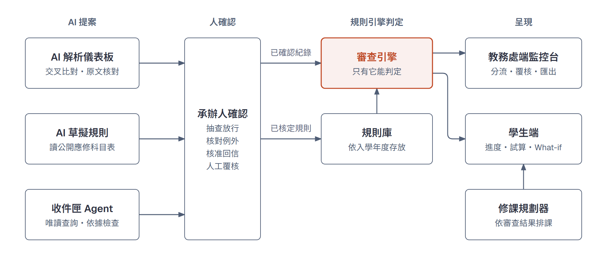
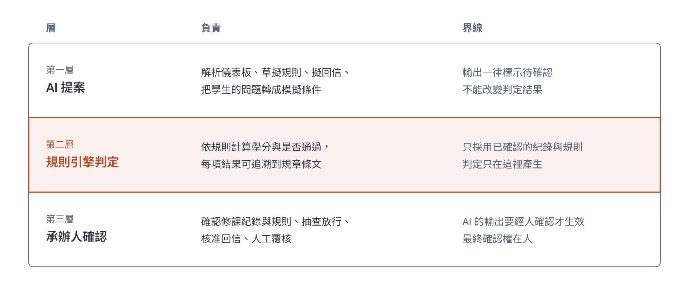
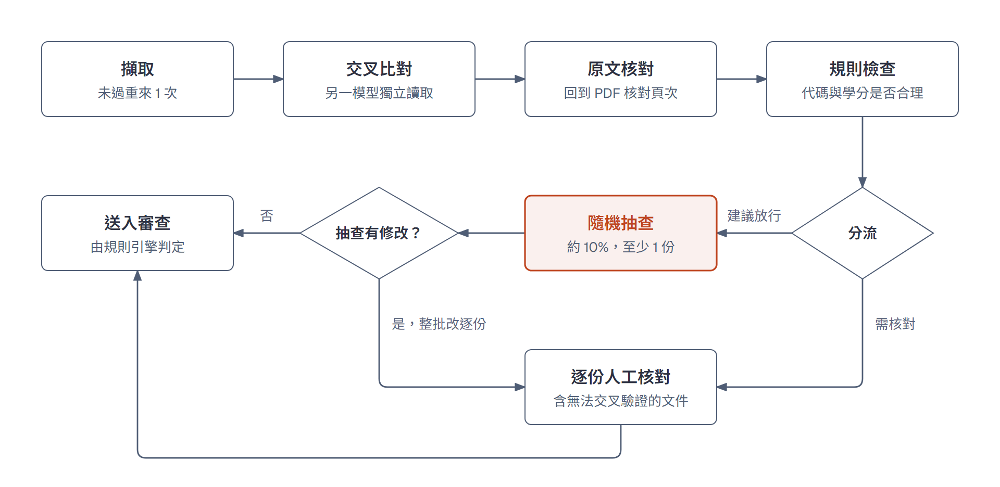
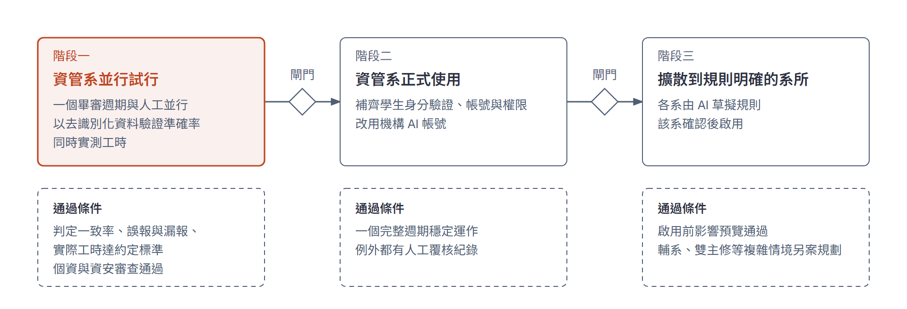

# Academic Twin 成果報告書（定稿前版本）

更新日期：2026-11-10。依簡章規定的章節編排；標【待填】處由隊上補上後輸出 PDF。設計與核對紀錄見 [成果報告書設計](REPORT_PLAN.md)。

- **主題類別**：【待填：依報名資料】
- **題目**：【待填：依報名資料】
- **組序／隊名**：【待填】
- **參賽人員／指導老師**：【待填】

## 計畫摘要

中央大學的畢業審查最後仍靠承辦人逐份、逐列人工判讀，一個系約要在兩週內完成；校務系統只做「一個蘿蔔一個坑」的比對，也讓學生誤以為自己不能畢業。

Academic Twin 是資管系大學部的畢業審查輔助系統，由 AI 提案、規則引擎判定、承辦人確認。教務處端由 AI 讀取畢審儀表板並擬學生回信，每一步都有程式檢核，人只處理例外、抽查放行、核准回覆；學生端把真正缺修與可能的系統誤判分開，並能用一句話試算修課情境。

除了一份組員本人同意提供的真實畢審儀表板，驗證都使用虛構學生資料。那份真實儀表板的 45 筆修課紀錄、225 個欄位，AI 全部擷取正確，但程式檢核與規則代碼對照尚未支援真實版型。在 24 份虛構儀表板中，主模型成功的 22 份共 7,974 個欄位全部正確；AI 依真實公開的應修科目表草擬的 3 項規則，內容與人工建置一致。採建議的模型組合時，需人優先查看的列降到約 10%；學生端的一句話 What-if 在 90 題次中沒有提出錯誤條件。這些結果只說明系統可行，尚未以真實資料驗證，也未量測實際節省的工時。

因此我們建議先在資管系並行試行一學期，用真實比對補上實證，達標後再正式使用，並以 AI 草擬規則擴散到規則明確的系所。

## 一、研究動機與問題定義

畢業審查最後仍靠承辦人逐份、逐列人工判讀，而且時間緊迫；校務系統的比對方式又造成學生誤解。以下痛點來自 2026-10-14 訪談教務處負責資管系畢審的承辦人的紀錄。

| 痛點 | 承辦人的說法 | 系統怎麼解 |
|---|---|---|
| 沒有總表，只能逐份看 | 系統不會匯出總表；「資料帶出後一定要一個一個點進去看」 | AI 解析儀表板，監控台分流，人只看例外與抽查 |
| 時程緊 | 一個系約在兩週內審完；學期初暑修、重修成績進來要再審 | 背景批次處理；紀錄更新後立即重審 |
| 超修、放錯類別不會算 | 「系統只會一個蘿蔔一個坑」，超修學分「必須以純人工方式加回來」 | 審查引擎標出「可能是校務系統誤判」與可移入外系的學分 |
| 重複修習永遠不合格 | 第二次以上不算學分、必須交給人工；學生看到「不合格」會擔心來電 | 標示可重複修習，學生端分開「真正缺修」與「可能誤判」 |
| 停開課要辦抵修 | 辦理前儀表板仍顯示缺課，需另做人工抵修 | 提示「未辦抵修」並列為待辦 |
| 學生來信多 | 「Gmail 很多，需一封一封點開、查完回覆」 | 收件匣 AI 先查資料、擬稿，承辦人核准 |
| 規則每年微調 | 「一律依學生入學當年度的教務章則審查」，延畢生亦同 | 規則依入學年度存放與取用 |

承辦人聽完構想表示「如果是這樣會很好，會很喜歡用」，並建議先以規則明確的資管系做起；看過初版原型後的回饋是「比原本一整張表拉那麼長、要自己判定好多了，直接把重點摘要出來，看得比較清楚」。

本階段尚未處理的痛點有兩項：加修輔系、雙主修、學分學程的學生「最花時間」，列為後續階段；規則代碼「沒有公開介面」造成的名稱混亂，目前只能附上規章出處，代碼對照待承辦人提供。

## 二、方法實施

本系統的設計原則是「AI 做得多，但每一步都能被檢查」：AI 讀文件、擬稿與提案，判定只由規則引擎產生，無法驗證的結果照實標出並交給人。

### 2.1 系統架構

*圖 1：系統架構。AI 的輸出經承辦人確認後，才由審查引擎判定。*

教務處端與學生端共用同一條解析流程與審查引擎，同一位學生、同一份資料在兩端得到相同判定，並由自動測試把關。系統由四個核心模組組成：規則知識庫、畢業資格審查、課程關係分析、修課路徑規劃。

### 2.2 AI 三層分工

*圖 2：AI 三層分工與各層界線。*

1. **AI 提案**：解析儀表板、草擬規則、擬回信、把學生的問題轉成模擬條件；輸出一律標示待確認。
2. **規則引擎判定**：學分與是否通過只由程式依規則計算，可追溯到規章條文；AI 不能改變結果。
3. **承辦人確認**：AI 擷取的修課紀錄經程式檢核後由人確認才進入審查；AI 擬的回信要經核准，系統不串接真實寄信。

### 2.3 教務處端：從逐份核對到監控

*圖 3：四道檢查點與分流。建議放行仍須先通過隨機抽查。*

承辦人上傳儀表板 PDF，AI 在背景逐份擷取修課紀錄，每份經過四道檢查點：

1. **擷取**：輸出須通過格式檢核，未過時把原因回饋模型重來 1 次，仍失敗轉人工。
2. **交叉比對**：由另一個模型獨立讀取，不一致的列標為優先核對。
3. **原文核對**：回到 PDF 原文核對頁次與引文。
4. **規則檢查**：檢查規則代碼、學分等是否合理。

結果自動分流為「建議放行」與「需核對」。建議放行不等於自動放行：批次確認前，伺服器隨機抽查約 10%（至少 1 份）由人逐列核對，抽查只要有修改，整批就改回逐份核對。主模型逾時改用備援模型、因而與比對模型相同時，系統不假裝沒事，標出「未交叉驗證」請人逐列對照原文。

### 2.4 學生來信收件匣（Agentic AI）

AI 自行決定呼叫哪些唯讀工具查審查結果（最多 5 輪），只能查寄件學生本人。回覆中的數字、課號、要求編號與承辦單位都要能在工具結果中找到，否則反思 1 次，仍不通過就標示「無法確認」。資料更正等屬承辦人職權的信一律轉人工。AI 可提出覆核建議，由承辦人採用後才重審，重審後回信需重新擬稿。

### 2.5 AI 草擬規則

AI 依公開的應修科目表草擬規則，附年度、頁次與引文，並自動核對原文。草稿經承辦人確認後才能啟用，啟用前先以虛構案例預覽對判定的影響，啟用後可隨時還原。

### 2.6 學生端

- **分清真正缺修與可能誤判**：列出真正缺的課與學分，也標出可能是校務系統誤判的情況，以及要找哪個單位辦理。
- **本學期修課試算**：學校選課系統沒有公開介接，改由學生輸入本學期的課，假設及格後重新交給審查引擎試算。挑課選單來自學校課程查詢系統的公開頁面（資管系與管理學院）。
- **一句話 What-if**：學生用一句話提問，AI 只把問題轉成模擬條件，經程式檢核與學生確認後，由規劃器計算；AI 不計算結果。服務無法使用時改走手動選項。
- 學生端結果一律標示「試算」，正式結果以承辦人審查為準。

### 2.7 創新點

| 評分重點 | 本系統的做法 |
|---|---|
| 生成式 AI | 把畢審儀表板 PDF 讀成結構化修課紀錄並附頁次引文；依應修科目表草擬規則；擬學生回信；把學生的問題轉成模擬條件 |
| Agentic AI | 收件匣 agent 自行選用唯讀工具查資料、依據檢查與反思、提出覆核建議 |
| 跳脫傳統框架 | 校務系統只做「一個蘿蔔一個坑」比對；本系統另外偵測超修、重複修習、未辦抵修等「可能是系統誤判」的情況 |
| 可驗證的 AI | 兩個模型交叉比對；回到 PDF 原文核對頁次；檢核不過時自我修正 1 次；批次放行前伺服器隨機抽查；每次執行留軌跡 |
| 前瞻性 | 承辦人從「逐份核對」轉為「監控者」；規則庫可由 AI 依各系章則草擬後擴散 |
| 校務研究方法 | 由執行軌跡算出完成率、轉人工率、抽查結果；24 份基準集量測模型選擇；學生端先修關係與瓶頸課分析 |

## 三、分析結果

AI 在虛構案例上的擷取與分流大多正確，錯誤都被檢核擋下或交給人。除 1 份組員本人的真實儀表板外，全部是自編虛構資料、樣本小，只能說明可行，不能當成實際準確率。

### 3.1 評測總覽

| 評測 | 樣本 | 結果 | 模型／日期 |
|---|---|---|---|
| 儀表板擷取（瀏覽器實測） | 6 份虛構儀表板，299 列 | D04–D08 共 258 列與標準答案逐欄比對 100% 正確、無漏列多列（D03 41 列未另比對）；每份 34–47 秒，主模型逾時的一份改用備援共 137 秒 | 3.5 Flash＋2.5 Flash，2026-11-06，單次 |
| 儀表板擷取（真實版型） | 1 份組員本人的儀表板，經本人同意，5 頁、45 列 | 45 列無漏列多列，課號、課名、學分、成績、學期 225 個欄位全對，來源頁碼全對；程式檢核因版型不同提出 100 項錯誤，無法直接送入審查（見 3.2） | 3.5 Flash 過載，改由備援 2.5 Flash 完成，94 秒，2026-11-10，單次 |
| 收件匣（全題組） | 30 題 × 3 次，86 題次有結果 | 分類正確 70/86、分流正確 82/86、依據檢查未過 0 | 3.5 Flash-Lite，2026-11-07 |
| 收件匣（驗證組，溫度 0） | 15 題，13 題有結果 | 分流正確 13/13、分類 11/13、應提到的事實 12/13；可擬稿的 11 封中 10 封自動擬好；2 題模型失敗 | 3.5 Flash-Lite，2026-11-09 |
| 學生端 What-if 轉換 | 30 題 × 3 次，90 題次 | 完全正確 85/90；提出錯誤條件 0；另 5 次把問題判為不支援；不支援與提示注入題 24/24 正確拒絕 | 3.5 Flash-Lite，2026-11-09 |

分流正確是指該擬稿的擬稿、該轉人工的轉人工。收件匣未成功的題次是模型呼叫失敗，已轉人工。

### 3.2 基準量測：最便宜的模型組合也全對

24 份虛構儀表板中，主模型成功的 22 份、共 7,974 個欄位全部正確，沒有漏列或多列；另外 2 份因模型服務過載失敗，依設計轉人工。

| 指標 | 結果 |
|---|---|
| 主模型（3.5 Flash-Lite） | 22 份成功；欄位正確率 100%（7,974／7,974）；漏列 0、多列 0；整份全對 22／22 |
| 交叉比對模型（2.5 Flash-Lite） | 20 份成功；欄位正確率 99.2%（7,129／7,188）；漏列 3；整份全對 5／20 |
| 交叉驗證標出「需優先核對」 | 1,198 列中 44 列（3.7%），實際都沒錯 |
| 兩模型一致的列 | 1,154 列，錯誤 0 |
| 情境 | 10 類（跨頁長紀錄、重修、成績 59／60 邊界、抵免段落、全形括號課名等）欄位正確率皆 100% |
| 耗時與用量 | 10 分鐘；約 37 萬 token，換算付費約 US$0.46（本次使用免費方案） |

- **交叉驗證這次沒有錯可抓**：主模型全對，標出的 44 列都是誤報，所以抓錯率無法計算；它的代價是承辦人多看約 4% 的列。
- **限制**：虛構版型、每份只跑 1 次；2026-11-09 執行，提示版本 dashboard-v1。真實儀表板可能版面更亂或為掃描檔，準確率需在試行期重新量測。

建議的組合（主模型 3.5 Flash-Lite、比對模型 2.5 Flash）以同一批 24 份案例另外量測：

| 指標 | 結果 |
|---|---|
| 主模型 | 22 份成功；欄位正確率 100%（8,016／8,016）；漏列 0、多列 0；整份全對 22／22 |
| 比對模型（2.5 Flash） | 20 份成功；欄位正確率 99.8%（7,286／7,302）；漏列 0；整份全對 12／20 |
| 標出「需優先核對」 | 1,217 列中 19 列（1.6%），實際都沒錯，抓錯率同樣無法計算 |
| 費用 | 依實測 token 換算付費約 US$0.042／份，約為前述最便宜組合的 2 倍 |

比對模型換成 2.5 Flash 後，誤報的列數從 44 列降到 19 列，主模型的正確率不受影響。

**真實儀表板試測（2026-11-10）**：一位組員以本人的畢審儀表板（校務系統匯出的文字型 PDF，經本人同意）測試，人工以 PDF 原文逐列對照：

- **AI 擷取**：45 筆修課紀錄全數擷取，無漏列多列；課號、課名、學分、成績、學期共 225 個欄位全對，跨行的課名與「未到(Not Entered)」等成績也照原文抄錄。入學年度、應修與實得學分這些文件上宣告的數字也都讀對。
- **程式檢核尚未支援真實版型**：學期寫法（如 1131，而非 113-1）、5 位數規則代碼、文字成績都和虛構版型不同，檢核提出 100 項錯誤，系統依設計不讓這份送入審查。這是版型沒有對應好，不是 AI 抄錯，但代表要先補上真實版型的對照，才能進入試行。
- **限制**：只有 1 份，而且是組員本人的紀錄，不能當成全校的準確率。

### 3.3 AI 讀真實規章：草擬的規則與人工建置一致

這是本專案唯一使用真實校務文件的驗證：Gemini 3.5 Flash 讀系網公開的《資管系 114 學年度應修科目表》（2026-11-06），草擬 3 項畢業要求，與團隊人工建置的規則庫比對。

| 比對 | 結果 |
|---|---|
| 實質欄位（課號清單、類別、學分門檻） | 3 項全部一致：院訂必修 7 門課號、國文 5 學分、最低畢業 128 學分 |
| 不同之處 | 只有標題與出處的寫法（如「院訂必修（21 學分）」寫成「院訂必修清單」） |
| 自動原文核對 | 1 則警示（國文引文在表格中不相連），內容其實正確，屬保守誤報 |
| 換進審查引擎後的判定 | 41 位虛構學生的總結果 41／41 相同、各要求結果 492／492 相同；另 173 個邊界案例未發現差異 |

範圍限制：114 規則庫共 12 項要求，AI 目前只草擬其中 3 項，且為單次執行；比對基準是團隊建置的規則庫，尚未經承辦人確認。規則內容相同時判定必然相同，因此主要證據是規則內容一致，判定比對用來確認換入後引擎行為不變。

### 3.4 人工作業量：從逐份逐列看，降到只看例外

現行作法依訪談是「一定要一個一個點進去看」，也就是所有份數與列數都由人看。下表是導入後仍需人親自核對的比例；未計時，節省的時間待試行量測。

| 批次 | 需人逐列核對的份數 | 需優先看的列 | 其餘 |
|---|---|---|---|
| 示範批次 6 份（3.5 Flash 讀＋2.5 Flash 比對） | 2 份（抽查 1、無法交叉驗證 1） | 約 93–104／299 列（31–35%，依抽到哪份而定） | 4 份經抽查後批次放行 |
| 基準量測 24 份（Flash-Lite 讀＋2.5 Flash-Lite 比對） | 15 份有標示列、2 份無法交叉驗證、2 份模型失敗轉人工 | 175／1,329 列（13.2%）；有標示的文件平均標 2.9 列 | 5 份可批次放行 |
| 基準量測 24 份（建議組合：Flash-Lite 讀＋2.5 Flash 比對） | 9 份有標示列、2 份無法交叉驗證、2 份模型失敗轉人工 | 138／1,336 列（10.3%） | 11 份可批次放行 |

- **比對模型不能太便宜**：比對用 2.5 Flash-Lite 時課名讀錯 41 處，誤報讓 15 份文件需要人看；換成 2.5 Flash 後課名讀錯 16 處，有標示的文件降為 9 份，可批次放行的從 5 份增加到 11 份。因此正式使用建議主模型用 Flash-Lite、比對模型用 2.5 Flash。
- 「需優先看的列」是檢核標出的列，加上無法交叉驗證文件的全部列；放行前另有約 10% 的隨機抽查。
- 學生來信：可擬稿的信 11 封中 10 封由 AI 擬好，承辦人從「自己查、自己寫」變成「看依據、按核准」。

### 3.5 安全合規

個資與送給 AI 的資料如下：

| 功能 | 送給 Gemini 的內容 | 不送的內容 |
|---|---|---|
| 解析儀表板 | 儀表板 PDF（實際使用時含修課與成績） | — |
| 學生來信擬稿 | 來信內容、審查結果中的要求與缺額 | 學號、成績分數；信中出現其他學生學號時整封不送，直接轉人工 |
| 學生 What-if | 問題、修課路徑的課號課名、可選學期 | 學號、成績 |
| 草擬規則 | 公開的應修科目表 | — |

- 儀表板含成績，正式使用前需取得學校個資與資安單位同意，並使用不將內容用於訓練的付費或機構帳號。
- 執行軌跡與用量紀錄只記計數與代號（模型、提示版本、檢核結果、token 數），不記學號、成績或原文。
- 收件匣的查詢工具是唯讀白名單，只能查寄件學生本人。
- 展示的評審模式只播放虛構文件的錄製結果，畫面標示「重播：模型・產生時間」。

### 3.6 尚未驗證的項目

- 真實儀表板版型的擷取準確率，以及與承辦人判定的一致率：目前只有 1 份組員本人的儀表板（3.2），程式檢核與規則代碼對照尚未支援真實版型，也還沒有承辦人判定可比對。
- 承辦人實際節省的時間：未計時。
- 學生端一句話 What-if 的實際使用情況：3.1 的 30 題由團隊自行設計，只用一位虛構學生，量測模型為 3.5 Flash-Lite。問法含「會延畢嗎」時較容易被判為不支援（5 次未轉換全屬此類），學生仍可改用手動選項；尚未以真實學生的問法量測。
- 自我修正在真實模型上尚未觸發過；這代表檢核沒有發現錯誤，不代表功能已被證實有效。
- 正式權限尚未完成：學生頁可輸入任一學號試算，確認紀錄尚未區分承辦人個人，因此不宣稱已完成全面安全合規。

## 四、單位因應策略與建議

建議分三階段導入：先在資管系試行一學期、與人工並行比對，達標後正式使用，再以 AI 草擬規則擴散到其他系所。承辦人的角色從「逐份核對、逐封回信」轉為「監控者」：只處理例外、抽查放行、核准回覆。

*圖 4：三階段導入與各階段的通過條件。*

| 階段 | 做法 | 通過條件（由教務處與團隊共同訂定） |
|---|---|---|
| 一、資管系並行試行 | 一個畢審週期與人工流程並行；取得去識別化資料驗證準確率，同時實測工時 | 判定一致率、誤報與漏報、實際工時達到約定標準；個資與資安審查通過 |
| 二、資管系正式使用 | 補齊學生身分驗證、承辦人帳號與權限；改用機構 AI 帳號 | 一個完整週期穩定運作，例外都有人工覆核紀錄 |
| 三、擴散到規則明確的系所 | 各系以公開科目表由 AI 草擬規則，該系確認後啟用 | 啟用前影響預覽通過；輔系、雙主修等複雜情境另案規劃 |

每一階段都要通過閘門才進入下一階段；試行期的並行比對同時補上目前缺少的真實實證數據。

### 4.1 導入條件

- **不需介接校務系統**：輸入是承辦人本來就有的畢審儀表板 PDF 與應屆名單 CSV；程式只用 Python 標準函式庫，一台電腦執行即可，工作狀態自動存檔、重開可接續。
- **AI 帳號要用付費或學校機構帳號**：Google 免費方案的內容會用於改進產品，不適合處理學生文件。
- **費用有上限**：以實測 token 數估算，一學期 60 位應屆生、300 封來信，目前設定約 US$6.9（約 NT$220）；儀表板主模型改用 Flash-Lite、比對仍用 2.5 Flash 約 US$2.8（約 NT$90），此組合已以 24 份基準集量測。系統另設每月 300 萬 token 預算，超過即停止呼叫模型、改走人工；失敗的呼叫也計入。
- **AI 停止不影響業務**：承辦人可隨時關閉所有 AI 呼叫；審查、覆核、匯出照常，儀表板改由人工輸入。

### 4.2 單位分工（建議，待相關單位確認）

| 單位 | 做什麼 |
|---|---|
| 教務處承辦人 | 監控分流、抽查放行、核對例外、核准學生來信回覆、人工覆核 |
| 各系規則核定者（系主任或課程委員會，待確認） | 每年新版應修科目表由 AI 草擬規則，經核定後才啟用；啟用前看影響預覽，可隨時還原 |
| 校務研究辦公室／電算中心 | 提供機構 AI 帳號與預算、個資與資安審查、學生登入方式 |
| 課務組 | 提供開課資料（本學期目前取自公開的課程查詢系統，其他學期為推估） |
| 學生 | 自查進度與試算、用一句話問 What-if；疑似誤判依待辦找承辦單位 |

### 4.3 長期維運

- **規則年度化**：規則依入學年度存放，延畢生仍用自己年度；新年度只新增一份，不改舊的。目前規則庫只有 114 學年度。
- **模型可替換**：模型名稱用設定決定；換模型前先跑 24 份虛構基準集，準確率不降才換。
- **可追溯**：每次 AI 執行都留軌跡（模型、提示版本、檢核結果、是否轉人工），不記學號與成績；監控台顯示完成率、轉人工率與抽查結果。

### 4.4 擴散到其他系所

各系只需要自己的應修科目表：AI 依公開的科目表草擬規則，附頁次與引文、自動核對原文，經該系確認後啟用；審查引擎、監控台、收件匣與學生端共用。目前 AI 草擬只驗證了 114 年度的 3 項要求，擴散前需先補齊其他規則類型。承辦人也提醒，規則彈性大的學系需要大量例外處理，應優先擴散到規則明確的系所。

### 4.5 資料來源與取得

目前學生資料除 1 份組員本人同意提供的儀表板外全部虛構，畢業規則來自真實公開文件。

| 資料 | 目前 | 正式導入由誰提供 | 狀態 |
|---|---|---|---|
| 學生修課紀錄 | 程式自製的虛構畢審儀表板 PDF，版面依訪談描述仿製 | 畢審承辦人自校務系統儀表板取得 | 學生端匯出的 1 份已確認為文字型 PDF（3.2）；承辦人端可否批次匯出待確認 |
| 應屆名單、英文門檻 | 虛構 CSV | 承辦人；英文門檻由語言中心登錄 | 待確認匯出格式 |
| 畢業規則 | 公開的 114 學年度應修科目表（真實） | 各系公開的歷年教務章則 | 已使用 |
| 開課資料 | 本學期取自課程查詢系統公開頁面（資管系與管理學院）；其他學期依科目表推估 | 課務組 | 部分取得 |
| 學生來信 | 虛構示範信 | 承辦人信箱 | 未串接，手動匯入 |

本校相關規定：

- **驗證用資料有正式管道**：依《校務研究資料系統建置及使用作業要點》（113 年 6 月修正），資料經電算中心與校務研究辦公室去識別化後釋出。學生須由指導老師代為申請，流程為平台填單並簽保密同意書、單位主管簽核、校務研究辦公室核定、下載、結案與銷毀切結；機敏資料需資料權責單位同意。
- **該資料只能做統計分析**：要點第五點明文「不得作為其他非統計分析之目的及用途」，不能拿來審查個別學生。
- **正式導入依個資政策辦理**：本校個人資料保護政策要求在特定目的必要範圍內利用；委外廠商須遵循個資管理制度並簽保密契約，國際傳輸依個資法辦理。校內未見針對雲端 AI 服務的明文規定，送外部 AI 需先經個資與資安單位審查。

因此試行階段先由指導老師申請去識別化資料驗證準確率，同時與教務處、個資單位確認正式使用的資料取得與 AI 委外方式。

### 4.6 導入前仍需解決

- 學生身分驗證：目前學生頁可輸入任一學號試算。
- 校務系統的畢審代碼對照與真實儀表板版型：已從 1 份真實儀表板看到版面（5 位數規則代碼、1131 式學期、文字成績），檢核與對照表要依此補上；正式代碼意義待承辦人確認。
- 114 以外年度的正式規則來源與核定。

## 五、結論

Academic Twin 證明了一件事：AI 可以承擔畢業審查中最耗人力的讀取與擬稿，同時不讓 AI 決定學生能不能畢業。

- **已完成**：教務處端的解析、分流、抽查、收件匣與規則草擬，以及學生端的試算與 What-if，已整合為可操作的系統，並以 400 項自動測試把關。
- **目前的證據**：虛構案例上擷取與分流大多正確；1 份真實儀表板的 225 個欄位全部擷取正確；AI 依真實規章草擬的 3 項規則與人工建置一致；採建議組合時需人優先查看的列降到約 10%；學生端 What-if 未提出錯誤條件。
- **主要限制**：真實資料只測了 1 份，程式檢核尚未支援真實版型，也未量測工時；AI 草擬只涵蓋 3 項要求；正式權限尚未完成；輔系、雙主修等最耗時的情境尚未處理。

下一步是在資管系並行試行一學期，用真實比對決定是否進入正式使用。

## 附錄：引用來源

- 規則依據：資管系 114 學年度應修科目表、資管系大學部課程地圖、學校共同必修規定、111 學年度畢審說明（均為公開文件）。
- 開課資料：國立中央大學課程查詢系統公開頁面。
- 校內規定：《校務研究資料系統建置及使用作業要點》、本校個人資料保護政策。
- AI 模型：Google Gemini API（gemini-3.5-flash、gemini-2.5-flash、gemini-3.5-flash-lite、gemini-2.5-flash-lite）。
- 展示與量測資料：本專案自行產生的虛構儀表板、虛構學生與虛構來信；另有 1 份組員本人同意提供的真實儀表板，只用於 3.2 的試測，內容不公開、不進版控。
- 需求訪談：2026-10-14 教務處負責資管系畢審的承辦人。
- 程式只用 Python 標準函式庫，無第三方套件。
