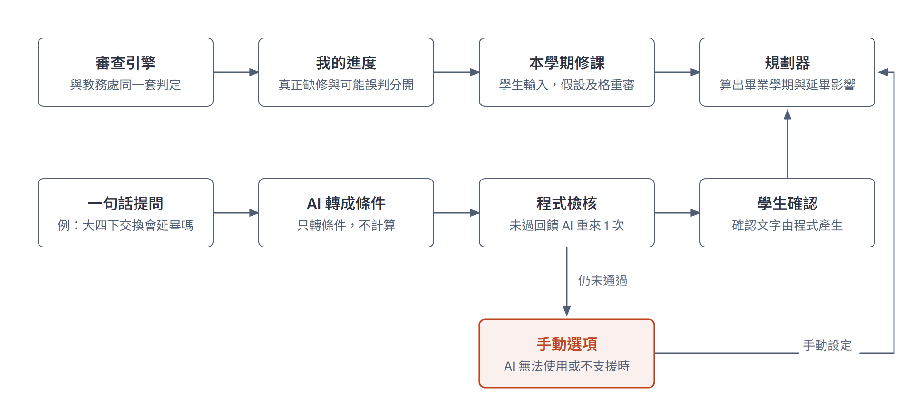
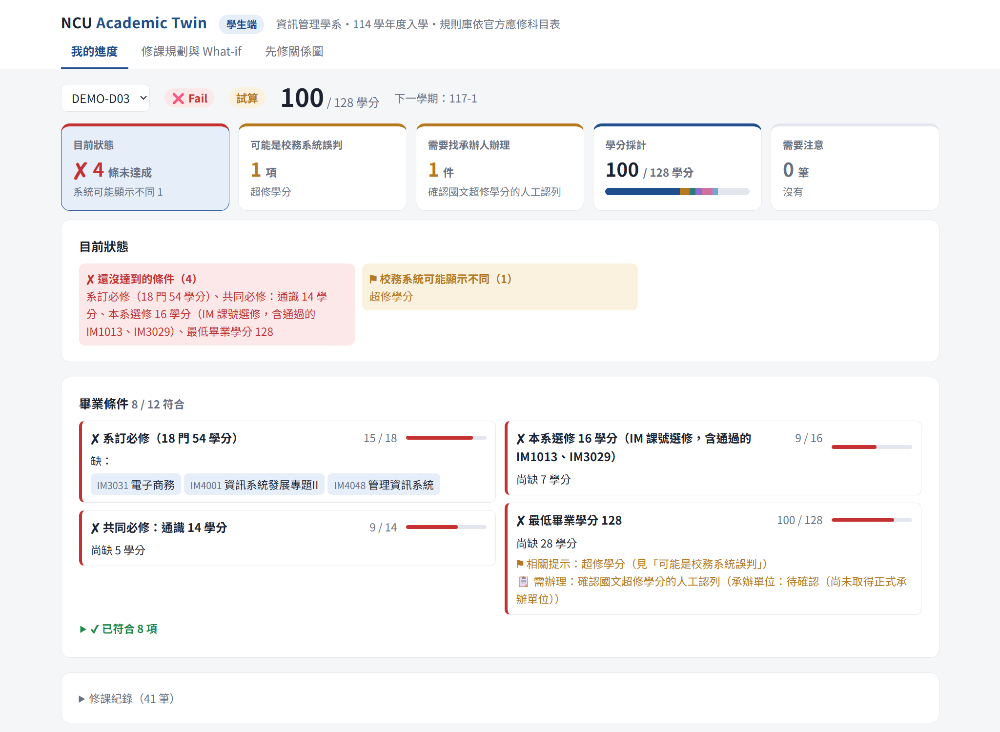

# Academic Twin 成果報告書（定稿前版本）

更新日期：2026-11-10。依簡章規定的章節編排；標【待填】處由隊上補上後輸出 PDF。設計與核對紀錄見 [成果報告書設計](REPORT_PLAN.md)。

- **主題類別**：【待填：依報名資料】
- **題目**：【待填：依報名資料】
- **組序／隊名**：【待填】
- **參賽人員／指導老師**：【待填】

## 計畫摘要

中央大學的畢業審查最後仍靠承辦人逐份、逐列人工判讀，一個系約要在兩週內完成；校務系統只做「一個蘿蔔一個坑」的比對，也讓學生誤以為自己不能畢業。

Academic Twin 專注於資管系，目的是為了讓資管系大學部的畢業審查能夠更加的便利。本系統雙管齊下，分為教務處端以及學生端，兩端共用同一套審查引擎。教務處端由 AI 提案、規則引擎判定、承辦人確認。 AI 讀取畢審儀表板並自動擬學生回信，每一步都有程式檢核，專員的身分變為監看者，只處理例外、抽查放行，以及核准回覆。學生端則是學生的「學業分身」：把真正缺修與可能的校務系統誤判分開，並指出要找哪個單位辦理；學生輸入本學期修的課就能試算，也能用一句話問「大四下去交換會不會延畢」，AI 只把問題轉成模擬條件，由規劃器依先修關係、開課學期與學分上限算出畢業學期與受影響的課。學生先自己看懂進度，查不懂再寄信，由教務處端的收件匣接手。

除了 4 份組員本人同意提供的真實畢審儀表板，驗證都使用虛構學生資料。4 份真實儀表板共 171 筆修課紀錄、855 個欄位，AI 全部擷取正確；其中 3 份在程式不改的情況下獨立測試，找出 1 個程式錯誤（「不通過」被當成通過）並當天修正。走完全流程的 3 份，各項畢業要求的通過與否都與校務系統儀表板一致，只有一份的英文門檻因英檢成績不在修課紀錄中而不同；其中 2 份的總學分比儀表板多，差額都是儀表板未計入、應修科目表允許認列的通識超修，這是訪談時已知的現有系統問題，也正是學生端會標為「校務系統可能顯示不同」的情況。在 24 份虛構儀表板中，主模型成功的欄位解析部分全部正確；AI 依真實公開的應修科目表草擬全部 12 項畢業要求，條件完整寫在科目表上的 7 項，4 次草擬每次都與人工建置一致，其餘錯誤多數由程式擋下。採建議的模型組合時，需人優先查看的列降到約 10%。學生端在示範案例中，從「未通過」、真正缺修與可能誤判的區分，到本學期試算與交換延畢的推演，每個數字都有自動測試核對，兩端判定一致也由自動測試把關；一句話 What-if 在 90 次測試中沒有提出錯誤的模擬條件。

因此我們期望先在資管系並行試行一學期，用真實比對補上實證，達標後再正式使用，日後可往外擴散到其他系所。

## 一、研究動機與問題定義

畢業審查最後仍靠承辦人逐份、逐列人工判讀，而且時間緊迫；校務系統的比對方式又不易解讀，讓學生容易誤解，也產生許多的詢問電話與郵件。以下痛點來自 2026-10-14 訪談教務處負責資管系畢審的承辦人的紀錄。

| 痛點         | 承辦人的說法                          | 系統怎麼解                      |
| ---------- | ------------------------------- | -------------------------- |
| 沒有總表，只能逐份看 | 系統不會匯出總表；「資料帶出後一定要一個一個點進去看」     | AI 解析儀表板，監控台分流，人只看例外與抽查    |
| 時程緊        | 一個系約在兩週內審完；學期初暑修、重修成績進來要再審      | 背景批次處理；紀錄更新後立即重審           |
| 超修、放錯類別不會算 | 「系統只會一個蘿蔔一個坑」，超修學分「必須以純人工方式加回來」 | 審查引擎標出「可能是校務系統誤判」與可移入外系的學分 |
| 重複修習永遠不合格  | 第二次以上不算學分、必須交給人工；學生看到「不合格」會擔心來電 | 標示可重複修習，學生端分開「真正缺修」與「可能誤判」 |
| 停開課要辦抵修    | 辦理前儀表板仍顯示缺課，需另做人工抵修             | 提示「未辦抵修」並列為待辦              |
| 學生來信多      | 「Gmail 很多，需一封一封點開、查完回覆」         | 收件匣 AI 先查資料、擬稿，承辦人核准       |
| 規則每年微調     | 「一律依學生入學當年度的教務章則審查」，延畢生亦同       | 規則依入學年度存放與取用               |

從學生的角度看，同一份儀表板帶來三種困擾：

- **看到「不合格」不知道是不是真的缺**：超修的學分沒算進去、可重複修習的課永遠不合格、停開課辦抵修前仍顯示缺課，這些都和真正缺修混在一起。承辦人說，學生看到「不合格」會擔心，就打電話來問。
- **看不懂、也查不到要找誰**：規則代碼名稱與系上用語不同；需要人工認列或抵修時，儀表板也不會寫要找哪個單位。
- **儀表板只看得到過去**：校務系統只列出已修的課，無法回答「這學期都過了能不能畢業」「某門課沒過會不會延畢」「去交換一學期會延幾學期」。答案取決於先修關係與開課學期，學生多半只能自己翻科目表推算，或寫信問承辦人。

前兩項直接變成承辦人的電話與來信，第三項則影響學生選課與出國的決定。因此本系統把學生端與教務處端同等看待：學生端先讓學生自己看懂、自己試算，看不懂的再由收件匣接手。

承辦人聽完構想表示「如果是這樣會很好，會很喜歡用」，並建議先以規則明確的資管系做起；看過初版原型後的回饋是「比原本一整張表拉那麼長、要自己判定好多了，直接把重點摘要出來，看得比較清楚」。

本階段尚未處理的痛點有兩項：加修輔系、雙主修、學分學程的學生「最花時間」，列為後續階段；規則代碼「沒有公開介面」造成的名稱混亂，目前只能附上規章出處，代碼對照待承辦人提供。

## 二、方法實施

本系統的設計原則是「AI 做得多，但每一步都能被檢查」：AI 讀文件、擬稿與提案，判定只由規則引擎產生，無法驗證的結果照實標出並交給人。

### 2.1 系統架構

*圖 1：系統架構。AI 的輸出經承辦人確認後，才由審查引擎判定。*

教務處端與學生端共用同一條解析流程與審查引擎，同一位學生、同一份資料在兩端得到相同判定，並由自動測試把關。系統由四個核心模組組成：規則知識庫、畢業資格審查、課程關係分析、修課路徑規劃。

### 2.2 AI 三層分工

*圖 2：AI 三層分工與各層界線。*

1. **AI 提案**：解析儀表板、草擬規則、擬回信、把學生的問題轉成模擬條件；輸出一律標示待確認。
2. **規則引擎判定**：學分與是否通過只由程式依規則計算，可追溯到規章條文；AI 不能改變結果。
3. **承辦人確認**：AI 擷取的修課紀錄經程式檢核後由人確認才進入審查；自動擬的回信要經核准，系統不串接真實寄信。

### 2.3 教務處端：從逐份核對到監控

*圖 3：四道檢查點與分流。建議放行仍須先通過隨機抽查。*

承辦人上傳儀表板 PDF，AI 在背景逐份擷取修課紀錄，每份經過四道檢查點：

1. **擷取**：輸出須通過格式檢核，未過時把原因回饋模型重來 1 次，仍失敗轉人工。
2. **交叉比對**：由另一個模型獨立讀取，不一致的列標為優先核對。
3. **原文核對**：回到 PDF 原文核對頁次與引文。
4. **規則檢查**：檢查規則代碼、學分等是否合理。

結果自動分流為「建議放行」與「需核對」。建議放行不等於自動放行：批次確認前，伺服器隨機抽查約 10%（至少 1 份）由人逐列核對，抽查只要有修改，整批就改回逐份核對。主模型逾時會改用備援模型；若備援模型剛好與比對模型相同，兩者無法互相驗證，系統不假裝沒事，標出「未交叉驗證」請人逐列對照原文。

### 2.4 學生來信收件匣（Agentic AI）

AI 自行決定呼叫哪些唯讀工具查審查結果（最多 5 輪），只能查寄件學生本人。回覆中的數字、課號、要求編號與承辦單位都要能在工具結果中找到，否則把不符之處回饋 AI 修正 1次，仍不通過就標示「無法確認」。資料更正等屬承辦人職權的信一律轉人工。AI 可提出覆核建議，由承辦人採用後才重審，重審後回信需重新擬稿。

### 2.5 AI 草擬規則

每年應修科目表微調時，不必改程式：AI 讀系上公開的應修科目表，草擬成規則，每條附上年度、頁次與原文引文，程式再回到原文核對引文是否確實存在。草稿只是提案，經承辦人確認才會啟用。啟用前，系統先用一批虛構學生比較新舊規則，列出判定會改變的學生，讓人檢查規則有沒有寫錯；啟用後若發現問題，可隨時退回舊版。

### 2.6 學生端：從看不懂儀表板到自己試算

*圖 4：學生端流程。判定來自審查引擎，推演來自規劃器；AI 只把問題轉成條件，學生確認後才計算。*

學生端讀取的是教務處端同一套審查引擎的結果，並由自動測試確認兩端判定一致（見 3.5）。學生端只分類與呈現審查結果，不自己計算學分，也不改變判定。所有畫面一律標示「試算」，正式結果以承辦人審查為準。學生端分三個分頁。

**我的進度：分清真正缺修與可能誤判**

*圖 5：學生端「我的進度」（虛構學生 DEMO-D03）。上排五塊摘要，下方是未符合的畢業條件；已符合的 8 項收成一行。*

畫面上排是五塊摘要：目前狀態、可能是校務系統誤判、需要找承辦人辦理、學分採計、需要注意。點選任一塊，下方顯示細節。未通過的條件再分成四類，讓學生知道自己該做什麼：

| 分類 | 什麼情況 | 學生該做什麼 |
|---|---|---|
| 還沒達到 | 真正缺的課或學分 | 自己修 |
| 辦理抵修後可能符合 | 缺的課全部是停開課，而且已修過替代課 | 找承辦單位辦理抵修 |
| 校務系統可能顯示不同 | 類別超修可移入外系學分池、可重複修習的課 | 找承辦人人工認列，不是真的缺 |
| 待確認 | 他校抵免等規則庫無法判定的紀錄 | 等承辦人覆核 |

這些提示由審查引擎偵測，不是學生端自己判斷。每條要求列出缺哪些課（附課名）、還差幾學分；滑鼠移到卡片上會浮出規章出處。需辦理的事項列出事項類型與承辦單位，承辦單位尚未取得時照實標示「待確認」。

**修課規劃與 What-if：往後推演**

規劃器從學生目前的狀態往後排課，排到畢業為止。它遵守三項限制：正式擋修與建議先修、每門課的開課學期、每學期 25 學分上限。先修鏈最長的課優先排，避免瓶頸課拖到最後。剩下的學分用通識、本系選修等補滿。學生可以在這裡做三種試算：

1. **本學期修課**：學校選課系統沒有公開介接，改由學生輸入本學期修的課（最多 15 門）。勾選的課假設及格，與既有紀錄一起重新交給審查引擎；取消勾選代表「這門可能沒過」，規劃器會重新排入。規則庫有的課，課名與學分以規則庫為準，不採用學生填寫的內容。挑課選單來自學校課程查詢系統的公開頁面，2026-11-09 實際抓取 115-1 學期資管系與管理學院 23 門學士班課程。輸入只存在學生自己的瀏覽器，伺服器不保存，也不影響教務處端的正式審查。
2. **手動情境**：某門課某學期不修；從某學期起出國交換或休學，連續 1–4 學期，並可設定每學期可抵的學分。
3. **一句話 What-if**：學生直接打字提問，例如「大四下去交換一學期會延畢嗎」。AI 只把問題轉成上一項的模擬條件。程式檢核課號要在修課路徑上、學期要在 8 學期內、學分要在合理範圍，未通過時把原因回饋 AI 重來 1 次。確認文字由程式依條件產生，學生按「確認並模擬」後才交給規劃器計算。AI 失敗、不支援或服務無法使用時改走手動選項，不支援的情境會明說不支援。

結果並排呈現：原本與模擬後的畢業學期、延後幾學期，以及哪些課從哪一學期被推到哪一學期。開課學期除了本學期，其他學期都是依科目表推估，畫面上會標示。

【待補截圖：What-if 確認畫面與模擬結果。可從學生端自動導覽錄影（`student.html?id=DEMO-D03&tour`）擷取 1:10–2:00 的畫面】

**先修關係圖：找出瓶頸課**

先修關係圖把 114 學年度規則庫的 28 門課與 14 條先修關係畫成圖，並列出瓶頸課。瓶頸課就是擋住最多後續課、位在最長先修鏈上的課。例如初階程式設計（IM1013）往後擋住 9 門課，從它往下最長的先修鏈有 7 門課，晚修一學期就可能一路往後推。點選任一門課，畫面會標出它的所有先修課與後續課。

**個資與 AI 的界線**

一句話 What-if 送給 AI 的只有問題、修課路徑上的課號課名與可選學期，不含學號與成績。執行軌跡（模型、提示版本、檢核結果、是否轉手動）顯示在畫面上，也寫入紀錄，但不記問題原文。學生端的 AI 呼叫同樣受每月 token 預算限制，評審模式可重播錄製結果，並標示「重播」。

### 2.7 創新點

| 評分重點       | 本系統的做法                                                    |
| ---------- | --------------------------------------------------------- |
| 生成式 AI     | 把畢審儀表板 PDF 讀成結構化修課紀錄並附頁次引文；依應修科目表草擬規則；擬學生回信；把學生的問題轉成模擬條件  |
| Agentic AI | 收件匣 agent 自行選用唯讀工具查資料、依據檢查與反思、提出覆核建議                      |
| 跳脫傳統框架     | 校務系統只做「一個蘿蔔一個坑」比對；本系統另外偵測超修、重複修習、未辦抵修等「可能是系統誤判」的情況，並在學生端與真正缺修分開呈現        |
| 學業分身       | 儀表板只看得到過去；學生端依先修關係、開課學期與學分上限往後推演，回答「這學期都過能不能畢業」「去交換會延幾學期」，判定與教務處同一套引擎 |
| 可驗證的 AI    | 兩個模型交叉比對；回到 PDF 原文核對頁次；檢核不過時自我修正 1 次；批次放行前伺服器隨機抽查；每次執行留軌跡 |
| 前瞻性        | 承辦人從「逐份核對」轉為「監控者」；學生先自查、自己試算，看不懂再寄信；規則庫可由 AI 依各系章則草擬後擴散                     |
| 校務研究方法     | 由執行軌跡算出完成率、轉人工率、抽查結果；24 份基準集量測模型選擇；學生端先修關係與瓶頸課分析          |

## 三、分析結果

本章用三類資料驗證系統：4 份真實畢審儀表板、真實公開的應修科目表，以及團隊自編的虛構案例。AI 的擷取與擬稿大多正確，出錯時會被程式檢核擋下或交給人。但真實儀表板只有 4 份、虛構案例樣本小，只能說明系統可行，不能當成實際準確率。

**驗證資料一覽**

| 名稱 | 內容 | 用來驗證 | 節 |
|---|---|---|---|
| 真實試測 | 4 份組員本人的畢審儀表板（經本人同意，共 171 筆修課紀錄） | 系統能否處理校務系統真正匯出的文件 | 3.1 |
| 虛構基準集 | 24 份虛構儀表板，涵蓋 10 類情境，每份附標準答案 | AI 擷取的準確率、模型組合的選擇 | 3.2 |
| 示範批次 | 6 份虛構儀表板，共 299 筆，即 Demo 影片中上傳的那一批 | 在實際操作畫面中走完整流程 | 3.2、3.6 |
| 真實規章 | 系網公開的資管系 114 學年度應修科目表 | AI 草擬規則 | 3.3 |
| 虛構來信 | 30 封虛構學生來信 | 收件匣的分類與擬稿 | 3.4 |
| 學生端示範案例 | 虛構學生 DEMO-D03（示範批次的主角，與教務處端同一位） | 學生端從進度、誤判提示到本學期試算與 What-if 的完整流程 | 3.5 |
| What-if 題組 | 30 個學生問法，由團隊自擬 | 一句話 What-if | 3.5 |

### 3.1 真實儀表板試測：4 份組員本人的儀表板

4 位組員以本人的畢審儀表板測試，都是校務系統匯出的文字型 PDF，經本人同意使用，內容不公開、不進版控。我們以 PDF 原文逐筆對照 AI 的結果。第 1 份（P1，2026-11-10）用來建立真實版型的轉換；另外 3 份（P2–P4，2026-11-11）先在程式不改的情況下直接測試，當作獨立驗證。

**AI 擷取：4 份共 171 筆、855 個欄位全對**

| 代號 | 修課紀錄 | 擷取結果（課號、課名、學分、成績、學期） | 模型 |
|---|---|---|---|
| P1 | 45 筆 | 沒有漏抄或多抄，225 個欄位全對 | 主模型過載，由備援 2.5 Flash 完成 |
| P2 | 47 筆 | 沒有漏抄或多抄，235 個欄位全對 | 主模型額度用完，由備援 2.5 Flash 完成 |
| P3 | 39 筆 | 沒有漏抄或多抄，195 個欄位全對 | 3.5 Flash |
| P4 | 40 筆 | 沒有漏抄或多抄，200 個欄位全對；但入學年度把 113 讀成 2024 | 主模型額度用完，由備援 2.5 Flash 完成 |

**獨立驗證找到的問題（程式不改直接測）**

- **P2**：檢核錯誤 0，可以直接送審。
- **P3、P4 出現 P1 沒有的成績寫法**：「抵免(Transferred)」「免修(Exempted)」「停修(Withdrawn)」。檢核報錯，系統依設計不讓這兩份送審。AI 依檢核理由重新擷取 1 次，這是自我修正第一次在真實模型上觸發；但文件上確實這樣寫，重新擷取的結果相同，仍轉給人處理。AI 沒有為了通過檢查而改寫內容，這是正確的行為。
- **P4 入學年度讀錯**：系統找不到 2024 學年度的規則，因此擋下。
- **程式錯誤**：P4 有 2 門課的成績是「一般課程不通過(Fail)」，程式因為字串裡有「通過」兩個字，把它換成了通過。P4 因上述錯誤被擋下，沒有進入審查；但如果送審，不及格的課會被算進學分。這是只用 1 份資料測不到的錯誤，也是做獨立驗證的原因。

**當天修正後重跑**：補上這幾種寫法的處理。不通過以不及格計入；抵免依儀表板的「通過」判定計入，並提醒承辦人確認抵免已核定；停修不列入審查；免修只接受在不審查的操行段落，其他段落仍報錯。重跑結果：

- **P2、P3**：檢核錯誤 0，走完擷取、檢核、確認、審查全流程。
- **P4**：主模型與備援模型的免費額度都已用完，只能改用 2.5 Flash-Lite。這次有 26 筆的規則代碼讀成上層段落代碼、1 筆學期讀錯，檢核全部擋下並轉人工，沒有送審。

**與校務系統儀表板的判定比對（走完全流程的 P1–P3）**

| 代號 | 判定 | 差異 |
|---|---|---|
| P1 | 各項畢業要求的通過與否都一致 | 總學分本系統 83、儀表板 82：儀表板沒有計入 1 學分通識超修 |
| P2 | 英文門檻以外都一致 | 總學分本系統 89、儀表板 85：儀表板沒有計入 4 學分通識超修。英文門檻儀表板為完成，但英檢成績不在修課紀錄裡，本系統要由應屆名單提供（語言中心登錄），沒有提供時判為未通過 |
| P3 | 全部一致，總學分都是 61 | 無；6 筆抵免依儀表板判定計入 |

應修科目表備註二-2 明定通識超修最多 4 學分可計入畢業學分（含在外系 12 學分上限內），本系統照此計入。P1、P2 的總學分差異都來自儀表板沒有計入這部分，正是承辦人說的「一個蘿蔔一個坑」：超修學分系統不會算，要靠人工加回來。逐條對照規則、附上出處的審查，可以幫承辦人找出這類情況。

限制：

- 樣本只有 4 份，都是資管系 113 學年度入學的組員本人，不能當成全校的準確率。
- 4 份都沒有完成交叉驗證：主模型過載或額度用完後改用備援模型，剛好與比對模型相同，系統照實標為「未交叉驗證」。
- 規則代碼的對照是依段落標題推定，抵免、免修的採計方式也是團隊依儀表板判定推定，正式意義待承辦人確認；113 規則庫也待承辦人核定。

### 3.2 虛構基準集：AI 擷取的準確率

24 份虛構儀表板每份都附標準答案，涵蓋 10 類容易出錯的情境，例如跨頁的長紀錄、重修、成績 59／60 分邊界、抵免段落、全形括號課名。以建議的模型組合（主模型 3.5 Flash-Lite 擷取、比對模型 2.5 Flash 獨立再讀一次）量測，結果如下：

| 指標 | 結果 |
|---|---|
| 主模型擷取 | 22 份成功，8,016 個欄位全對，沒有漏抄或多抄，22 份整份全對；另 2 份因模型服務過載失敗，依設計轉人工 |
| 比對模型擷取 | 20 份成功，欄位正確率 99.8%（7,286／7,302），沒有漏抄 |
| 標為「需優先核對」 | 1,217 筆中 19 筆（1.6%），實際都沒有錯 |
| 10 類情境 | 欄位正確率皆為 100% |
| 費用 | 依實測 token 數換算，約 US$0.042／份 |

- **這批案例中交叉比對沒有錯可抓**：主模型全對，標出的 19 筆都是比對模型讀錯造成的誤報，所以「交叉比對能抓到多少錯」無法計算。它目前的代價是承辦人要多看一些其實沒錯的資料。
- **比對模型不能太便宜**：同一批案例改用更便宜的 2.5 Flash-Lite 當比對模型，主模型同樣全對（7,974／7,974），但比對模型的正確率降到 99.2%，誤報從 19 筆增加到 44 筆（3.7%），費用約為建議組合的一半。這是我們建議組合的依據（見 3.6）。
- **限制**：虛構版型，每份只跑 1 次（2026-11-09，提示版本 dashboard-v1）。真實儀表板可能版面更亂或是掃描檔，準確率要在試行期重新量測。

**示範批次的實際操作**：2026-11-06 在網頁上實際上傳示範批次的 6 份（主模型 3.5 Flash、比對模型 2.5 Flash）。其中 5 份、258 筆與標準答案逐欄比對，全部正確、沒有漏抄或多抄；另 1 份（41 筆）當天直接確認送審，沒有另外比對。每份費時 34–47 秒。有 1 份主模型逾時，改用備援模型共 137 秒；因為備援模型剛好就是比對模型，無法互相驗證，系統照實標為「未交叉驗證」，請人逐筆對照原文（見 3.6）。

### 3.3 AI 讀真實規章：12 項中 7 項每次都與人工建置一致

2026-11-10，AI 讀系網公開的《資管系 114 學年度應修科目表》，草擬 114 規則庫的全部 12 項畢業要求，再與團隊人工建置的規則庫逐項比對。一共呼叫 6 次，2 次因模型服務過載失敗；成功的 4 次中，2 次由主模型 3.5 Flash 完成，2 次由備援模型 2.5 Flash 完成（提示版本 rule-draft-v2）。比對時只看規則內容（型式、課號清單、類別、門數、學分門檻），標題與出處位置的寫法不同不算。

| 要求 | 4 次中規則內容一致 | 不一致時的情況 |
|---|---|---|
| 系訂必修 18 門、院訂必修 7 門、國文 5 學分、外文 6 學分、通識 14 學分、通識核心至少一個領域、最低畢業 128 學分（7 項） | 每項 4／4 | — |
| 本系選修 16 學分 | 3／4 | 1 次學分寫成 0，程式擋下，不能確認 |
| 服務學習 2 門 | 1／4 | 3 次把 0 學分的課寫成「學分門檻 0」，程式擋下，不能確認 |
| 必選課（須修過，不需及格） | 0／4 | 4 次都寫成「須及格」。「不需及格」的定義出自系上說明投影片，科目表沒有寫 |
| 體育 5 學期，須含大一體育 2 學期 | 0／4 | 3 次寫成學分門檻 0，程式擋下；1 次寫成 4 學期。「大一體育 2 學期」出自 111 學年度畢審說明，科目表沒有寫 |
| 英文畢業門檻 | 0／4 | 英檢標準由語言中心公告，科目表沒有寫。2 次門檻寫成 0，程式擋下；2 次誤寫成「外文 6 學分」，其中 1 次的引文被自動原文核對標為「可能是 AI 編造」 |

- **AI 錯誤由程式擋下**：不一致的 16 項次中，9 項次結構不合理（如門檻為 0），程式直接擋下，不能確認。
- **AI 錯誤由人確認**：另外 7 項次結構合法，程式擋不下來，要靠與現有規則的差異列表和人工核對原文抓出來。這正是草稿一定要經人確認才能啟用的原因。
- **錯在哪裡有規律**：4 次都一致的 7 項，條件都完整寫在科目表上；錯誤集中在需要其他文件（說明投影片、畢審說明、語言中心公告）才能確定的 3 項。要讓 AI 草擬完整規則庫，需要把這些文件一併提供。

限制：比對基準是團隊建置的規則庫，尚未經承辦人確認；4 次中 2 次是備援模型完成的；只用了 114 一份科目表。2026-11-06 另有一次舊版提示（rule-draft-v1）只草擬院訂必修、國文、最低畢業學分 3 項，內容與人工建置一致；換進審查引擎後，41 位虛構學生的總結果 41／41 相同，各項要求的結果 492／492 相同。

### 3.4 收件匣：AI 擬稿與轉人工

主模型為 3.5 Flash-Lite。「擬稿／轉人工判斷正確」指該擬稿的信擬了稿、該轉人工的信轉給人。

| 測試 | 樣本 | 結果 |
|---|---|---|
| 全部來信（2026-11-07） | 30 封各跑 3 次，共 90 次；86 次模型有回應 | 擬稿／轉人工判斷正確 82／86；信件類型判對 70／86；所有回信都通過依據檢查 |
| 驗證組（2026-11-09，溫度設為 0、結果固定） | 15 封各跑 1 次，13 次模型有回應 | 擬稿／轉人工判斷正確 13／13；信件類型判對 11／13；回信提到應提的事實 12／13；可擬稿的 11 封中 10 封由 AI 擬好 |

模型沒有回應的信，依設計轉給承辦人處理。

### 3.5 學生端：同一份結果，學生自己看得懂、算得出

學生端的驗證分三部分：兩端判定是否一致、示範案例走完全流程、AI 把問題轉成條件的正確率。

**兩端一致**：學生端不自己計算，所以最重要的是它和教務處端的結果相同。自動測試對每一位有修課紀錄的學生逐一比對兩端的審查結果，比對項目包括整體狀態、總學分、逐條要求、學分採計、提示、待辦與規則版本。承辦人覆核之後，兩端也要一致。這組測試失敗時，系統不能交付。

**示範案例 DEMO-D03**：虛構學生 DEMO-D03 是 114 學年度入學的資管系學生，修課紀錄到 116-2，現在是大四上（117-1）開學、成績還沒出來。這位學生也是教務處端示範批次的主角，承辦人在教務處端把一筆他校抵免覆核為本系選修後，學生端接著看到下表的結果。表中每個數字都由自動測試從審查引擎與規劃器的輸出核對；規則、規劃器或示範資料改變，導致數字變了，測試就會失敗。

| 學生想知道 | 學生端的回答 |
|---|---|
| 我是不是畢不了業？ | 未通過，可採計 100／128 學分。12 項畢業條件中 8 項已符合 |
| 真正缺什麼？ | 系訂必修缺電子商務（IM3031）、資訊系統發展專題II（IM4001）、管理資訊系統（IM4048）；通識 9／14 學分、本系選修 9／16 學分、總學分 100／128 |
| 哪些可能是系統誤判？ | 國文多修 2 學分，可納入外系學分池。這不是真的缺，要找承辦人人工認列 |
| 這學期 4 門都過呢？ | 學分 100 → 112，預估 117-2 畢業，照常畢業 |
| 如果管理資訊系統沒過？ | 學分 100 → 109。這門課只在上學期開，要排到 118-1，畢業延到 118-1 |
| 大四下去交換一學期？ | 畢業從 117-2 延到 118-2，延後 2 學期。電子商務只在下學期開，從 117-2 被推到 118-2 |

學生端回答這些問題時，畫面上都標示「試算」。學生在出國或選課前就知道哪門課是關鍵、要先找系上討論，不必先寫信問承辦人。

**同一套計算在真實儀表板上的意義**：3.1 的真實試測中，儀表板漏算 1 學分通識超修。總學分與學生端的「校務系統可能顯示不同」提示，由審查引擎的同一段計算產生。我們用 113 學年度規則庫和一份虛構紀錄（通識修了 15 學分，要求 14 學分）確認，審查引擎會提出「通識有 1 學分可納入外系學分池」的提示，並列入需辦理事項。換句話說，學生看到儀表板少算時，學生端會告訴學生這可能是系統限制，並指出要找承辦人認列。

**一句話 What-if 的轉換正確率**（2026-11-09，3.5 Flash-Lite）：

| 測試 | 樣本 | 結果 |
|---|---|---|
| 全部問法 | 30 個問法各跑 3 次，共 90 次 | 85 次轉出的條件完全正確；5 次判為「不支援」，學生可改用手動選項；**提出錯誤模擬條件 0 次** |
| 不支援與提示注入 | 系統不支援的問題，以及試圖誘導 AI 違規的問法，共 24 次 | 24／24 正確拒絕 |

AI 沒有一次把問題轉成錯的條件。轉不出來時寧可說不支援，交給手動選項，不會讓學生拿到錯的模擬結果。問法由團隊自擬，只用一位虛構學生，不代表真實學生的問法。

**自動測試**：學生端相關的自動測試共 61 項，包括兩端一致性 8 項、示範數字 6 項、規劃器 14 項、一句話 What-if 19 項、本學期修課試算 7 項、開課清單 7 項。

限制：示範案例是虛構學生，數字只證明系統照規則與規劃邏輯運作，不代表真實學生的規劃一定可行。規劃器使用 114 學年度規則庫，還沒有依入學年度切換（審查結果已依年度）。本學期以外的開課學期是推估，規劃器採貪婪法，排出的是一條可行路徑，不保證是最佳路徑。目前還沒有真實學生試用。

### 3.6 人工作業量：從逐份逐筆看，降到只看例外

依訪談，現行作法是「一定要一個一個點進去看」，所有份數、所有紀錄都由人看。下表是導入後仍需人看的部分。目前沒有計時，節省的時間要在試行期量測。

| 批次 | 整份要人看 | 部分紀錄要人看 | 可批次放行 | 需優先看的筆數 |
|---|---|---|---|---|
| 示範批次 6 份 | 2 份（隨機抽查 1 份、未交叉驗證 1 份） | 0 | 4 份 | 約 93–104／299 筆（31–35%，依抽到哪份而定） |
| 虛構基準集 24 份，建議組合 | 4 份（未交叉驗證 2 份、模型失敗 2 份） | 9 份 | 11 份 | 138／1,336 筆（10.3%） |
| 虛構基準集 24 份，便宜組合 | 4 份（同上） | 15 份 | 5 份 | 175／1,329 筆（13.2%） |

- 「需優先看的筆數」是檢核標出的紀錄，加上整份要人看的文件的全部紀錄。批次放行前，另有約 10% 的隨機抽查。
- 便宜組合的比對模型課名讀錯 41 處，誤報讓 15 份文件需要人看；建議組合讀錯 16 處，需要人看的降為 9 份，可批次放行的從 5 份增加到 11 份。
- 學生來信：可擬稿的 11 封中 10 封由 AI 擬好，承辦人從「自己查、自己寫」變成「看依據、按核准」。

### 3.7 安全合規

個資與送給 AI 的資料如下：

| 功能 | 送給 Gemini 的內容 | 不送的內容 |
|---|---|---|
| 解析儀表板 | 儀表板 PDF（實際使用時含修課與成績） | — |
| 學生來信擬稿 | 來信內容、審查結果中的要求與缺額 | 學號、成績分數；信中出現其他學生學號時整封不送，直接轉人工 |
| 學生 What-if | 問題、修課路徑的課號課名、可選學期 | 學號、成績 |
| 草擬規則 | 公開的應修科目表 | — |

- 儀表板含成績，正式使用前需取得學校個資與資安單位同意，並使用不將內容用於訓練的付費或機構帳號。
- 執行軌跡與用量紀錄只記計數與代號（模型、提示版本、檢核結果、token 數），不記學號、成績或原文。
- 收件匣的查詢工具是唯讀白名單，只能查寄件學生本人。
- 展示的評審模式只播放虛構文件的錄製結果，畫面標示「重播：模型・產生時間」。

### 3.8 尚未驗證的項目

- **真實儀表板的準確率，以及與承辦人判定的一致率**：目前只有 4 份組員本人的儀表板（3.1），都是 113 學年度入學；代碼對照依段落標題推定，也還沒有承辦人的判定可比對。
- **承辦人實際節省的時間**：未計時。
- **學生端的實際使用**：還沒有真實學生試用。3.5 的 30 個問法由團隊自擬，只用一位虛構學生；問法含「會延畢嗎」時較容易被判為不支援（5 次未轉換全屬此類），學生仍可改用手動選項，但尚未以真實學生的問法量測。
- **學生端能否減少來電與來信**：這是學生端最主要的預期效益，但目前沒有基準數字，要在試行期量測。
- **自我修正的成效**：尚未量測。真實試測中觸發過 2 次（P3、P4），但錯誤來自系統還不支援的成績寫法，不是 AI 抄錯，重新擷取結果相同；還沒有資料能評估它修正真實抄錯的效果。
- **正式權限**：尚未完成。學生頁可輸入任一學號試算，確認紀錄也還沒區分到承辦人個人，因此不宣稱已完成全面安全合規。

## 四、單位因應策略與建議

建議分三階段導入：先在資管系試行一學期、與人工並行比對，達標後正式使用，再以 AI 草擬規則擴散到其他系所。承辦人的角色從「逐份核對、逐封回信」轉為「監控者」：只處理例外、抽查放行、核准回覆。

*圖 6：三階段導入與各階段的通過條件。*

| 階段 | 做法 | 通過條件（由教務處與團隊共同訂定） |
|---|---|---|
| 一、資管系並行試行 | 一個畢審週期與人工流程並行；取得去識別化資料驗證準確率，同時實測工時。學生端開放應屆生自查與試算，收集真實問法 | 判定一致率、誤報與漏報、實際工時達到約定標準；學生端 What-if 以真實問法量測不出現錯誤條件；個資與資安審查通過 |
| 二、資管系正式使用 | 補齊學生身分驗證、承辦人帳號與權限；改用機構 AI 帳號；學生端開放全系在學生 | 一個完整週期穩定運作，例外都有人工覆核紀錄；學生來電與來信量與試行前比較 |
| 三、擴散到規則明確的系所 | 各系以公開科目表由 AI 草擬規則，該系確認後啟用 | 啟用前影響預覽通過；輔系、雙主修等複雜情境另案規劃 |

每一階段都要通過閘門才進入下一階段；試行期的並行比對同時補上目前缺少的真實實證數據。

### 4.1 導入條件

- **不需介接校務系統**：輸入是承辦人本來就有的畢審儀表板 PDF 與應屆名單 CSV；程式只用 Python 標準函式庫，一台電腦執行即可，工作狀態自動存檔、重開可接續。
- **AI 帳號要用付費或學校機構帳號**：Google 免費方案的內容會用於改進產品，不適合處理學生文件。
- **費用有上限**：以實測 token 數估算，一學期 60 位應屆生、300 封來信，目前設定約 US$6.9（約 NT$220）；儀表板主模型改用 Flash-Lite、比對仍用 2.5 Flash 約 US$2.8（約 NT$90），此組合已以 24 份基準集量測。系統另設每月 300 萬 token 預算，超過即停止呼叫模型、改走人工；失敗的呼叫也計入。
- **AI 停止不影響業務**：承辦人可隨時關閉所有 AI 呼叫；審查、覆核、匯出照常，儀表板改由人工輸入。

### 4.2 學生端導入

學生端與教務處端共用審查引擎與規則庫，不需另外維護一套規則。正式開放前要補上三件事：

- **學生登入，只能看自己**：目前學生頁可以輸入任一學號試算。正式開放前要接上學校的登入方式，學生只能查自己的資料。
- **學生端讀取承辦人確認過的資料**：目前同一套系統內，承辦人覆核後學生端立即反映。3.5 的示範案例中，承辦人把他校抵免覆核為本系選修，學生端就從「待人工判斷、97 學分」變為「未通過、100 學分」，覆核後兩端一致也由自動測試把關。正式導入時，要決定學生端資料的來源（學生自行上傳儀表板，或由承辦人確認後帶入），並確認尚未覆核的項目在學生端標示為「待確認」。
- **開課資料**：本學期的開課清單目前取自課程查詢系統的公開頁面，但只涵蓋資管系與管理學院；其他學期仍依科目表推估。若課務組能提供歷年開課與下學期預排，規劃與 What-if 的延畢推估會更準。

學生端的效益要在試行期量測：學生來電與來信是否減少、學生是否找得到要辦的事與承辦單位，以及用一句話 What-if 的真實問法轉換正確率。量測方式可以比照教務處端，從執行軌跡算出使用次數、轉手動比例，再請學生填寫簡短問卷。

### 4.3 單位分工（建議，待相關單位確認）

| 單位 | 做什麼 |
|---|---|
| 教務處承辦人 | 監控分流、抽查放行、核對例外、核准學生來信回覆、人工覆核 |
| 各系規則核定者（系主任或課程委員會，待確認） | 每年新版應修科目表由 AI 草擬規則，經核定後才啟用；啟用前看影響預覽，可隨時還原 |
| 校務研究辦公室／電算中心 | 提供機構 AI 帳號與預算、個資與資安審查、學生登入方式 |
| 課務組 | 提供開課資料（本學期目前取自公開的課程查詢系統，其他學期為推估） |
| 學生 | 自查進度與試算、用一句話問 What-if；疑似誤判依待辦找承辦單位；看不懂再寄信，由收件匣接手 |

### 4.4 長期維運

- **規則年度化**：規則依入學年度存放，延畢生仍用自己年度；新年度只新增一份，不改舊的。目前規則庫有 114 與 113 學年度（113 與 114 內容相同，待承辦人核定）。
- **模型可替換**：模型名稱用設定決定；換模型前先跑 24 份虛構基準集，準確率不降才換。
- **可追溯**：每次 AI 執行都留軌跡（模型、提示版本、檢核結果、是否轉人工），不記學號與成績；監控台顯示完成率、轉人工率與抽查結果。

### 4.5 擴散到其他系所

各系只需要自己的應修科目表：AI 依公開的科目表草擬規則，附頁次與引文、自動核對原文，經該系確認後啟用；審查引擎、監控台、收件匣與學生端共用。目前 AI 草擬只驗證了 114 年度一份科目表：12 項中，條件完整寫在科目表上的 7 項每次都正確；需要其他文件才能確定的項目（如必選課定義、英檢標準）會出錯，擴散時要把這些文件一併提供，並維持人工確認。承辦人也提醒，規則彈性大的學系需要大量例外處理，應優先擴散到規則明確的系所。

### 4.6 資料來源與取得

目前學生資料除 4 份組員本人同意提供的儀表板外全部虛構，畢業規則來自真實公開文件。

| 資料 | 目前 | 正式導入由誰提供 | 狀態 |
|---|---|---|---|
| 學生修課紀錄 | 程式自製的虛構畢審儀表板 PDF，版面依訪談描述仿製 | 畢審承辦人自校務系統儀表板取得 | 學生端匯出的 1 份已確認為文字型 PDF（3.1）；承辦人端可否批次匯出待確認 |
| 應屆名單、英文門檻 | 虛構 CSV | 承辦人；英文門檻由語言中心登錄 | 待確認匯出格式 |
| 畢業規則 | 公開的 114 學年度應修科目表（真實） | 各系公開的歷年教務章則 | 已使用 |
| 開課資料 | 本學期取自課程查詢系統公開頁面（資管系與管理學院）；其他學期依科目表推估 | 課務組 | 部分取得 |
| 學生來信 | 虛構示範信 | 承辦人信箱 | 未串接，手動匯入 |

本校相關規定：

- **驗證用資料有正式管道**：依《校務研究資料系統建置及使用作業要點》（113 年 6 月修正），資料經電算中心與校務研究辦公室去識別化後釋出。學生須由指導老師代為申請，流程為平台填單並簽保密同意書、單位主管簽核、校務研究辦公室核定、下載、結案與銷毀切結；機敏資料需資料權責單位同意。
- **該資料只能做統計分析**：要點第五點明文「不得作為其他非統計分析之目的及用途」，不能拿來審查個別學生。
- **正式導入依個資政策辦理**：本校個人資料保護政策要求在特定目的必要範圍內利用；委外廠商須遵循個資管理制度並簽保密契約，國際傳輸依個資法辦理。校內未見針對雲端 AI 服務的明文規定，送外部 AI 需先經個資與資安單位審查。

因此試行階段先由指導老師申請去識別化資料驗證準確率，同時與教務處、個資單位確認正式使用的資料取得與 AI 委外方式。

### 4.7 導入前仍需解決

- 學生身分驗證：目前學生頁可輸入任一學號試算。
- 學生端的規劃與 What-if 依入學年度取用規則：審查結果已依年度，規劃器目前仍用 114 學年度規則庫。
- 校務系統的畢審代碼對照與真實儀表板版型：已依 4 份真實儀表板補上版型（5 位數規則代碼、1131 式學期、通過／不通過／抵免／停修等文字成績）；代碼對照為團隊推定，正式意義待承辦人確認。
- 114、113 以外年度的正式規則來源與核定；113 學年度規則與 114 版相同，同樣待承辦人核定。

## 五、結論

Academic Twin 證明了一件事：AI 可以承擔畢業審查中最耗人力的讀取與擬稿，同時不讓 AI 決定學生能不能畢業。

- **已完成**：教務處端的解析、分流、抽查、收件匣與規則草擬；學生端的進度與誤判分流、本學期修課試算、手動與一句話 What-if、先修關係圖。兩端共用同一套審查引擎，已整合為可操作的系統，並以 410 項自動測試把關，其中 61 項針對學生端。
- **目前的證據**：虛構案例上擷取與分流大多正確；4 份真實儀表板的 855 個欄位全部擷取正確，3 份走完全流程、判定與校務系統一致；AI 依真實規章草擬全部 12 項要求，其中 7 項 4 次都與人工建置一致；採建議組合時需人優先查看的列降到約 10%；學生端在示範案例中走完從「未通過」到交換延畢推演的全流程，數字皆由測試核對，What-if 在 90 次中未提出錯誤條件；真實儀表板漏算的通識超修，正是學生端會標出的「可能是校務系統誤判」。
- **主要限制**：真實資料只測了 4 份組員本人的儀表板，也未量測工時；AI 草擬遇到科目表沒寫明的條件會出錯，仍須人工確認；正式權限尚未完成；學生端還沒有真實學生試用；輔系、雙主修等最耗時的情境尚未處理。

下一步是在資管系並行試行一學期：教務處端用真實比對驗證準確率與工時，學生端開放應屆生使用、量測來電與來信是否減少，再決定是否進入正式使用。

## 附錄：引用來源

- 規則依據：資管系 114 學年度應修科目表、資管系大學部課程地圖、學校共同必修規定、111 學年度畢審說明（均為公開文件）。
- 開課資料：國立中央大學課程查詢系統公開頁面。
- 校內規定：《校務研究資料系統建置及使用作業要點》、本校個人資料保護政策。
- AI 模型：Google Gemini API（gemini-3.5-flash、gemini-2.5-flash、gemini-3.5-flash-lite、gemini-2.5-flash-lite）。
- 展示與量測資料：本專案自行產生的虛構儀表板、虛構學生與虛構來信；另有 4 份組員本人同意提供的真實儀表板，只用於 3.1 的試測，內容不公開、不進版控。
- 需求訪談：2026-10-14 教務處負責資管系畢審的承辦人。
- 程式只用 Python 標準函式庫，無第三方套件。
