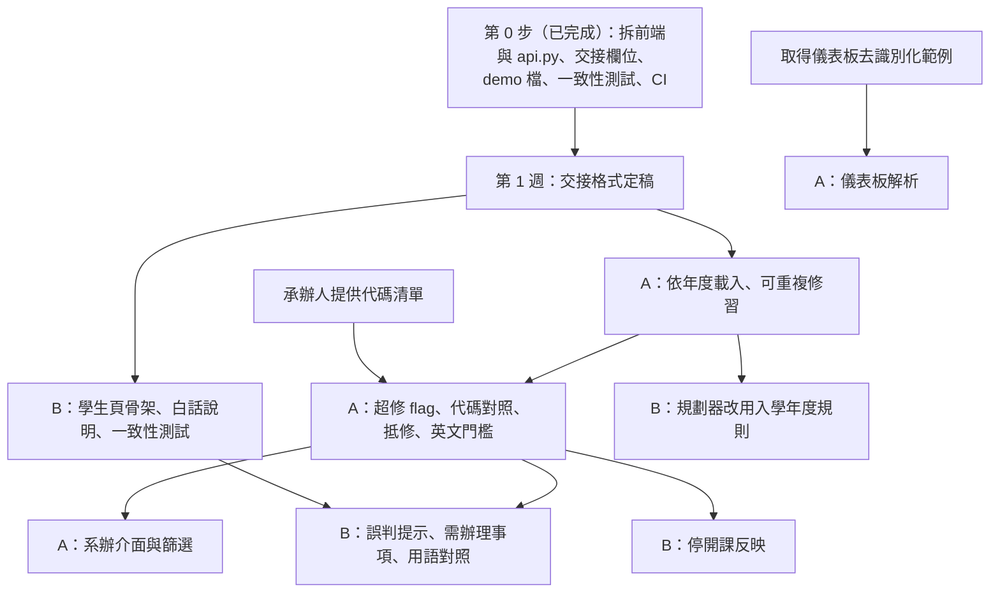

# 兩組分工計畫

更新日期：2026-10-21（A 組新增少量規則草稿與確認存檔；依[比賽目標](#比賽目標與收斂原則)收斂工作項目）。架構以 [專案設計與主要流程](PROJECT_DESIGN.md) 為準；工作項目對應 [實作狀態](IMPLEMENTATION_STATUS.md) 的待建置優先序。本文是兩組（含各自的 AI agent）的工作準則，協作流程見[協作規則](#協作規則)；交接格式細節由兩組在第 1 週確認後定稿。

## 分組原則

系統分為學校端與學生端，但兩端共用同一套審查核心（[雙端架構](PROJECT_DESIGN.md#雙端架構)）。規則依年度取用、可重複修習與儀表板解析都影響兩端共用的資料與判定，因此不能把專案直接切成「學校端／學生端」兩半，而是：

| 組 | 範圍 | 一句話職責 |
|---|---|---|
| A 組 | 系辦端＋審查核心 | 決定「判定是什麼」：規則庫、審查引擎、資料匯入、覆核、匯出、系辦介面 |
| B 組 | 學生端＋推演 | 決定「學生怎麼看懂、往後怎麼走」：白話說明、誤判提示與需辦理事項的呈現、修課規劃、What-if、學生介面 |

核心歸 A 組的理由：

1. **都是判定邏輯**：依年度載入、可重複修習、超修、抵修都會改變審查結果，必須集中在同一組維護，才能保證「同一份資料在兩端得到相同判定」（[學生端驗收條件](STUDENT_REQUIREMENTS.md#個人修業進度)）。
2. **需求來源是承辦人**：這些規則來自 [2026-10-14 承辦人訪談](MEETING_NOTES_2026-10-14.md)，後續規則確認、代碼清單、儀表板範例也都要向承辦人取得，由 A 組統一對接。
3. **學生端不改判定**：學生端結果標示為「試算」，只呈現與推演審查結果；說明文字與規劃器不應自行更改學分或判定（[分工原則](PROJECT_DESIGN.md#ai規則引擎系辦與學生分工)）。

兩組之間唯一的正式交接點是**審查結果的資料格式**（見[交接格式](#交接格式)）。B 組只讀取審查結果，不直接呼叫 `rule_engine.py` 內部函式。

## 比賽目標與收斂原則

本專案參加 [2026 中大 AI 校務治理實務競賽](https://ir.ncu.edu.tw/p/406-1034-216,r11.php?Lang=zh-tw)（校務研究辦公室主辦）。工作項目依比賽收斂：與評分無關的邊緣功能延後到賽後。

| 時程 | 內容 |
|---|---|
| 115-11-11（三）23:59 | 繳交成果報告書、Demo 影片（4 分鐘內）、上台簡報、A0 海報 |
| 115-11-12 至 11-18 | 初審：只看成果報告書與影片 |
| 115-11-20（五） | 入圍公告 |
| 115-11-27（五） | 決賽：簡報 5 分鐘、問答 4 分鐘；海報展與人氣投票 |

評分四項各占 25%，工作項目對應如下：

| 評分 | 簡章說明（摘要） | 本專案的回應 |
|---|---|---|
| 重要性 | 對應行政核心痛點，AI 實質提升行政效能或決策品質 | 承辦人逐一點開儀表板、自行查規則；校務系統誤判讓學生以為不能畢業 |
| 創新性 | 結合生成式 AI、Agentic AI、大數據或 IR 方法 | 系辦端：AI 解析儀表板、依章則草擬規則；學生端：AI 自然語言 What-if；批次審查 agent 為選配 |
| 實證性 | 以客觀校務數據與科學方法驗證；推論過程扎實且安全合規 | 以去識別化案例比對引擎與承辦人判定；量測 AI 解析與規則草擬的準確度；判定可追溯到規章 |
| 可行性 | 能實際導入、穩定；有單位因應策略、執行藍圖、長期維運與擴散價值 | 系辦批次總表與人工覆核；規則依年度載入；AI 草擬規則庫讓其他系所可複製 |

**AI 三層分工**（兩組都不得違反）：

1. **AI 提案**：解析文件、草擬規則、整理待辦、白話說明。AI 輸出一律標示為待確認。
2. **規則引擎判定**：學分與 `status`、`satisfied` 只由 `knowledge_base.py`、`rule_engine.py` 產生。AI 不得直接改變判定結果。
3. **承辦人確認**：AI 解析的紀錄、AI 草擬的規則，經驗證器檢查並由承辦人確認後才進入審查。

### 最小展示流程與範圍

比賽展示系辦端與學生端各占一半（影片各約 2 分鐘），兩端共用同一條解析流程與審查引擎。

**系辦流程**：**上傳去識別化儀表板 → AI 擷取並對照原文 → 承辦人確認 → 依已確認的年度規則審查 → 呈現 flags 與待辦 → 人工覆核、重審與匯出**。AI 草擬規則先展示單一年度、少數有明確來源的要求，證明如何擴展規則庫。

**學生流程**：**查看自己的學分狀態 → 看到疑似誤判與需辦理事項 → 用一句話問 What-if → AI 轉成模擬條件並由學生確認 → 規劃器計算 → 依計算結果回答**。學生端結果一律標示為試算。

- 先列明支援的文件版型與是否支援掃描件；不支援、缺頁、無法辨識的文件須顯示失敗或待確認，不能當成沒有修課紀錄。
- 主流程完成且取得實證數據後，再決定是否加入 Agentic 助理。整理批次結果可以先由固定流程呼叫 AI；只有確實由模型選擇並呼叫工具時，才稱為 Agentic。
- AI 服務未定時，先做解析結果的驗證與確認流程、flags、年度載入及虛構案例。預先保存的 AI 輸出可供重播，但影片與展示須標明重播、模型與產生時間。
- `flags` 表示待確認情況；「與校務系統結果不同」須經承辦人依正式規章確認後，才能計入「已確認誤判」。虛構案例只能證明功能，不能作為實際誤判件數或行政效益的證據。

### AI 輸入與啟用驗收

| 對象 | 必須檢查 | 確認與失敗處理 |
|---|---|---|
| 儀表板擷取 | 格式驗證之外，逐列保留來源頁碼、原文對照；檢查漏列、重複、課號、學分、成績與學期。模型信心分數只作提示，不能證明正確 | 所有擷取結果均須供承辦人確認；有未解決疑義時不送入正式審查，不能靜默略過錯誤列 |
| 規則草稿 | 每條附適用年度、原文位置與引用，檢查門檻、適用條件、例外及遺漏；結構合法不代表規章解讀正確 | 草稿與已啟用規則分開，保留修改及確認紀錄；確認後才以新版本啟用。現有 114 JSON 含待確認假設，不能直接視為完整標準答案 |
| AI 說明／待辦 | 引用審查結果中的要求或 flag；不得創造規章、學分、承辦單位或完成狀態 | 標示草稿供人確認；服務逾時或失敗時仍能查看既有引擎結果與使用現有覆核、匯出功能 |

來源對照與草稿確認資訊先由 A 組匯入／規則草擬流程管理；本次計畫補充不新增 `student()` 欄位。若後續需改正式交接格式，仍走[交接格式變更](#交接格式變更)。

### 實證從第一階段開始

A 組先與承辦人確認案例、人工答案與量測方式，再開發及調整功能。案例至少涵蓋一般通過、真正缺修、三種 flag、解析錯誤或漏列、年度規則缺失；虛構測試與去識別化實務案例分開統計。保留未用於調整提示或規則的驗證案例，避免只量測反覆修改過的展示案例。

| 指標 | 計算與報告方式 |
|---|---|
| AI 擷取 | 分別報告人工修改前、修改後的欄位正確數／人工答案欄位總數，並列出漏列、額外列與整份文件完全正確的件數；缺漏列納入錯誤 |
| AI 規則草擬 | 對照承辦人確認的來源，逐項列出正確、錯誤、漏列與多列的規則，以及人工修正時間；另測修正後規則的審查行為 |
| 審查與 flags | 分別報告逐條要求、整體狀態的一致件數與分母；各類 flag 列出正確提示、誤報、漏報。人工答案未確認的案例另列 |
| 行政時間 | 以相同案例與相同完成標準比較原流程和輔助流程，包含解析等待、核對與修正時間；記錄執行順序，報告案例數與中位時間 |

每次量測記錄案例集合版本、模型／提示版本、規則版本與測試日期，保留失敗案例。報告只使用經確認的彙總數據，列明樣本數、案例來源與限制；沒有實務資料時，明寫尚未驗證實際行政效益，不預填準確率或節省時間。

### 展示與導入的界線

現有 `reviews.py` 可支援覆核歷程展示；覆核人仍為自行填寫，尚無身分驗證，不能據此宣稱已完成正式權限控管或全面安全合規。選定 AI 服務前，由負責人確認送出資料範圍、服務端保存方式、費用與金鑰管理；只傳送經確認可使用且必要的去識別化內容。真實資料的本機驗證由承辦人執行，AI agent 不讀取；去識別化不代表自動取得外傳授權。

## 檔案歸屬

每個檔案有一個主人組。非主人組要修改時，請主人組修改，或發 PR 由主人組審查（見[協作規則](#協作規則)）。

### 程式

| 檔案 | 主人 | 說明 |
|---|---|---|
| `academic_twin/knowledge_base.py` | A | 規則庫載入與驗證；依年度載入在此實作 |
| `academic_twin/rule_engine.py` | A | 分類、採計、判定；新增 `flags`、`actions` 的偵測 |
| `academic_twin/records.py` | A | 修課紀錄 CSV 檢查；儀表板解析可另開模組，同屬 A |
| `academic_twin/roster.py` | A | 應屆名單比對與異常清單 |
| `academic_twin/reviews.py` | A | 人工覆核紀錄 |
| `academic_twin/report.py` | A | 系辦可列印的審查明細 |
| `academic_twin/demo_flags.py` | A | 啟動完全虛構的 flags 示範；覆核只存記憶體，不替換正式規則 |
| `academic_twin/evaluate.py` | A | 實證比對：審查結果對承辦人答案、原流程與輔助流程計時；只輸出彙總數字 |
| `academic_twin/graph.py` | B | 課程關係、瓶頸、循環檢查 |
| `academic_twin/planner.py` | B | 修課路徑規劃與情境 |
| 白話說明模組（新增，如 `academic_twin/explain.py`） | B | 依審查結果產生學生看得懂的說明；不改判定 |
| 自然語言 What-if 模組（新增，如 `academic_twin/ask.py`） | B | AI 將學生問題轉成 `simulate` 參數；計算與回答依據只來自規劃器結果 |
| `academic_twin/llm.py` | A（共用，變更需通知 B） | 以標準函式庫呼叫 Gemini；金鑰讀環境變數或未進版控的 `.env`；每個模型有總等待上限，主模型過載或逾時時改用備援模型；兩組的 AI 功能共用 |
| `academic_twin/dashboard.py` | A | AI 解析儀表板 PDF 為待確認紀錄（附來源頁碼與原文）、檢查、與標準答案比對 |
| `academic_twin/demo_dashboard.py` | A | 產生虛構儀表板 PDF 與標準答案（`data/samples/`） |
| `academic_twin/rule_draft.py` | A | AI 草擬 114 少量規則、來源與差異，重用知識庫驗證；人工確認只存獨立草稿，不啟用 |
| `academic_twin/rule_versions.py` | A | 已確認草稿產生新規則版本，由承辦人明確啟用、可還原；不覆寫正式規則庫 |
| 系辦審查助理（新增，如 `academic_twin/office_agent.py`） | A | 以 `CoreService` 為工具的 agent；只讀審查結果，不改判定 |
| `academic_twin/api.py` | A（共用，變更需通知 B） | `CoreService`：載入資料、`_report`、`rule_version`、`meta`、交接格式 `student()`；`AcademicTwinService` 組合兩端 |
| `academic_twin/office_api.py` | A | `OfficeMixin`：`data_source`、`batch`、`roster_anomalies`、`export_csv`、`add_review`、`report_html` |
| `academic_twin/student_api.py` | B | `StudentMixin`：`twin_ids`、`twin`（學生端試算）、`course_impact`、`simulate` |
| `web.py` | A | 路由依「共用／系辦端／學生端」分段；B 組新增學生端路由時發 PR 給 A |
| `app.py` | 共用 | 命令列：`--roster`、`--records`、`--export`、`--report`、`--assumptions` 屬 A；`--plan`、`--skip`、`--away`、`--away-credits`、`--course`、`--bottlenecks` 屬 B。改動以小 PR 進行 |
| `web/` | 依下表 | 第 0 步已把原本 655 行的單頁拆成系辦頁與學生頁 |

`web/` 拆分結果：

| 拆分後 | 主人 | 內容 |
|---|---|---|
| `web/index.html`、`web/assets/common.css`、`web/assets/common.js` | A（變更需通知 B） | 入口頁；樣式；API 呼叫、分頁切換、學分採計、畢業條件、修課紀錄等兩端共同呈現 |
| `web/office.html`、`web/assets/office.js` | A | 「系辦畢審」（資料上傳、總表、名單異常）、「學生明細」（審查結果與人工覆核）、「規則來源」 |
| `web/student.html`、`web/assets/student.js` | B | 「我的進度」（試算、誤判提示、需辦理事項、白話說明）、「修課規劃與 What-if」、「先修關係圖」 |
| `web/assets/demo-twin.json` | 共用 | 交接格式範例，`student.html?demo` 讀取；交接格式改了要一起更新（測試會檢查欄位一致） |

覆核操作只在系辦頁；學生頁只呈現結果，不提供覆核，也不顯示覆核歷程（承辦人內部紀錄）。

### 測試

| 檔案 | 主人 |
|---|---|
| `tests/test_rule_engine.py` | A |
| `tests/test_curriculum_114.py` | A |
| `tests/test_records.py` | A |
| `tests/test_roster.py` | A |
| `tests/test_reviews.py` | A |
| `tests/test_export.py` | A |
| `tests/test_cohort_rules.py` | A |
| `tests/test_dashboard.py` | A |
| `tests/test_rule_draft.py` | A |
| `tests/test_rule_versions.py` | A |
| `tests/test_evaluate.py` | A |
| `tests/test_planner.py` | B |
| `tests/test_contract.py`（交接格式與兩端一致性） | B 維護、A 審查；第 0 步已建立基本版 |
| `tests/fixtures/curriculum_sample.json` | A（B 需新增測試情境時發 PR） |

### 資料

| 路徑 | 主人 | 說明 |
|---|---|---|
| `data/curriculum_im_114.json` 及之後各年度規則庫 | A | 規則、代碼對照、可重複修習與抵修關係都在規則庫 |
| `data/sources/` | A | 原始規章來源 |
| `data/students/` | A | 示例紀錄與名單；B 需要新情境的示例學生時發 PR |
| `data/reviews/` | A | 覆核紀錄（執行時產生） |
| 白話說明文案（若獨立成資料檔） | B | 每條要求、每種 flag 的說明模板 |

### 文件

| 文件 | 主人 |
|---|---|
| [系辦端業務需求](OFFICE_REQUIREMENTS.md)、[畢業規則確認清單](OFFICE_QUESTIONS.md) | A |
| [學生端需求](STUDENT_REQUIREMENTS.md) | B |
| [專案設計與主要流程](PROJECT_DESIGN.md)、[實作狀態](IMPLEMENTATION_STATUS.md)、本文件 | 共用；各組完成項目時更新自己的段落 |
| `AGENTS.md`、`CLAUDE.md`（AI agent 工作準則）、`.github/`（CI、PR 範本） | 專案負責人 |

## 各組工作項目

優先序依[比賽目標](#比賽目標與收斂原則)排定。指導教授建議不必開發完整系統，集中強化比賽亮點：工作項目只保留直接對應評分的部分，其餘列入「賽後」，比賽期間不做。「依賴」欄指需要對方先交付的東西。

### A 組：系辦端＋審查核心

主線：**AI 讀資料與規章 → 規則引擎標示疑似誤判 → 承辦人確認 → 以實證數據評估效果**。

| 優先 | 項目 | 產出 | 驗收條件 | 對應評分 | 依賴 |
|---|---|---|---|---|---|
| 0 | 交接格式與 stub | **已完成**：`student()` 已輸出全部新增欄位；尚未偵測前 `flags`、`actions` 為空陣列、`system_code`、`regulation_term` 為 `null`；示意資料放在 `web/assets/demo-twin.json`，不混入真實結果 | B 組可依 demo 檔開發畫面；欄位定義經兩組確認 | — | 無 |
| 1 | AI 解析儀表板 | **已完成虛構版型與瀏覽器流程驗收**：Gemini 讀取示範 PDF，產生待確認紀錄與來源；系辦可修正欄位、頁碼與原文，修改後須重新確認，再送入審查；待接真實版型 | 虛構 17 列案例的實際瀏覽器確認結果與 CSV 路徑一致；含錯誤與新警示阻擋。真實案例正確率及漏列仍待量測 | 創新性、重要性、實證性 | 去識別化範例 |
| 1 | 誤判偵測 flags | **已完成核心與虛構案例驗證**：引擎產生 `overflow`（超修）、`repeatable`（可重複修習）、`substitution_pending`（未辦抵修）及對應 `actions`；未標示的重複通過列人工覆核 | 每種類型均有應提示與不應提示的案例；兩端輸出一致；虛構清單明確標示，不計入實際誤判數。個人抵修登錄另行建置 | 重要性 | 正式可重複修習、停開與替代清單仍待承辦人確認 |
| 1 | AI 草擬規則庫 | **已完成少量草稿與確認存檔（離線驗證）**：114 應修科目表的 R2、R4、R10 附年度、頁次、引文、條件與例外，經既有驗證器檢查並列出差異；CLI 與系辦頁可確認存檔；**已確認草稿可由承辦人明確啟用為新規則版本、可還原**（`rule_versions.py`），正式規則庫檔案不覆寫 | 新增 28 項替身測試；現有 114 JSON 只供差異核對，實際錯漏與修正時間待承辦人確認答案後量測。草稿與確認檔獨立保存、記錄修改數；啟用前再次驗證，尚未驗證規章解讀正確 | 創新性、可行性（擴散到其他系所） | AI 服務、正式規章與承辦人確認 |
| 1 | 實證設計與資料取得 | 先約定人工答案、案例集合、原流程時間與量測方法，開發期間累積結果。**比對工具已完成**：答案與計時格式、分組彙總（`evaluate.py`），以虛構案例驗證；待承辦人提供案例與答案 | 第一階段確認資料可取得與量測可執行；功能測試與實務驗證分列 | 實證性 | 承辦人配合；先以虛構案例建立流程 |
| 1 | 規則依入學年度取用（最小版） | **載入機制已完成**：年度選擇與缺年度阻擋，已用虛構規則測切換；待接已確認的 112 | 同批不同年度使用自己的規則，缺規則時列異常而不套其他年度；`rule_version` 帶出年度；來源未確認前不宣稱可做 112 正式審查 | 可行性 | 載入機制不依賴 AI；112 內容需正式來源與確認 |
| 2 | 實證驗證與彙整 | 依第一階段約定，比對 AI 擷取、規則草稿、審查及人工流程 | 報告可引用的彙總數據，包含樣本數、誤報／漏報、時間與限制；無資料時如實標記 | 實證性 | 第一階段案例與人工答案、可執行的主流程 |
| 2 | 系辦總表依 flag 篩選 | **已完成**：依三種 flag／有待辦／無提示篩選，可與狀態篩選併用；明細、CSV 與列印報告呈現提示及待辦 | 虛構案例可從總表定位案件、查看要求與課程、覆核未標示的重複通過並重審；抵修待辦仍需正式程序 | 可行性（展示） | 真實流程驗證仍待承辦人案例 |
| 選配 | 系辦審查助理（Agentic） | 主流程與實證完成後，才評估以 `CoreService` 為工具整理案件與草擬通知 | 只讀已確認輸入的審查結果，不改判定、不自動啟用規則或送出通知；有工具呼叫紀錄與失敗處理 | 創新性 | AI 服務、主流程與實證先完成 |
| 賽後 | 110、111 規則；完整代碼對照；英文門檻改讀登錄結果；系辦介面完整驗收；輔系、雙主修、學分學程；覆核人身分驗證；資料持久保存 | — | — | — | — |

代碼對照比賽期間只補 demo 用到的要求，其餘維持「待提供」。

A 組 flags 虛構示範使用 `data/curriculum_demo_flags.json` 與 `data/students/demo_flags_*.csv`（皆歸 A 組），不替換正式 114 規則。設定方式、案例與驗證限制見 [實作狀態](IMPLEMENTATION_STATUS.md#flags-虛構示範)。本次未更動正式交接格式；共用 `common.js` 僅新增學分圖目標的可選參數，學生端原呼叫方式維持預設值，PR 需 B 組與負責人審查。

### B 組：學生端＋推演

比賽展示系辦端與學生端各占一半。學生端主線：**我現在的學分狀態 → 哪些是疑似誤判、要找誰辦 → 用一句話問 What-if，看畢業路徑怎麼變**。學生端已有進度、修課路徑、What-if、課程影響與瓶頸課雛形，比賽期間以強化亮點為主。

| 優先 | 項目 | 產出 | 驗收條件 | 對應評分 | 依賴 |
|---|---|---|---|---|---|
| 0 | 依 stub 建學生頁骨架 | **已完成骨架**：學生頁有誤判提示區、需辦理事項區與「試算」標示；白話說明留有 `explain()` 掛點 | `student.html?demo` 可顯示示意資料 | — | — |
| 1 | 學分當前狀態 | 強化進度頁：一眼看出已修、缺修、超修；嵌入誤判提示（依 `flags` 分開「疑似校務系統誤判」與「真正缺修」）與需辦理事項（依 `actions` 列出事項與單位） | 不讓學生誤以為一定不能畢業，也不保證一定能畢業（[學生端驗收條件](STUDENT_REQUIREMENTS.md#個人修業進度)）；每項需辦理事項指出單位或承辦人 | 重要性 | 先用 `demo-twin.json`；A 組產生真實 flags、actions 後接上 |
| 1 | 白話說明 | 每種規則類型（`all_of`、`taken_all`、`n_of`、`credits_from`、`category_credits`、`category_count`、`dept_elective_credits`、`english_threshold`、`total_credits`）的說明模板；依審查結果填入數字與課名；有系統代碼與章則用語時並列，沒有時顯示「待提供」 | 每條要求都有說明；只引用審查結果，不自行計算或更改判定；附規章依據 | 重要性、可行性 | 無（可先以 114 規則庫撰寫） |
| 1 | What-if 強化 | 現有情境（某課某學期不修、出國交換）的結果更直觀：畢業學期變化、延畢學期數、受影響課程 | 結果全部來自 `simulate`；開課學期為推估時明確標示 | 重要性 | 無 |
| 1 | AI 自然語言 What-if | 學生用一句話提問；AI 只把問題轉成 `simulate` 參數並讓學生確認；規劃器計算；回答只引用計算結果 | 符合「AI 輸入與啟用驗收」的 AI 說明規定；轉不出參數或服務失敗時，退回手動選情境；不支援的情境明說不支援 | 創新性 | AI 服務 |
| 1 | 兩端一致性測試 | 基本版已在 `tests/test_contract.py`；擴充 flags 與年度載入情境 | 同一份資料在兩端判定完全相同；納入每次測試 | 實證性 | A 組 flags、年度載入 |
| 2 | 規劃器改用入學年度規則 | 規劃與 What-if 使用學生自己年度的規則庫 | 只限已確認的年度；缺年度規則時明示，不套其他年度 | 可行性 | A 組完成依年度載入 |
| 2 | 學生端實證 | AI 問題轉參數的正確率；小型使用測試（如看完頁面能否正確說出自己缺什麼、該找誰辦） | 報告列樣本數、題組與限制；使用測試以虛構學生資料進行，不使用受測者真實成績 | 實證性 | 測試題組、受測同學 |
| 2 | 比賽素材 | 學生端 demo 腳本、影片學生端段落、主導 A0 海報 | 11-06 前固定展示案例 | — | 展示案例 |
| 賽後 | 停開課反映、延畢預警、更多情境、多方案比較、輔系等加修試算 | 見 [學生端往後方向](STUDENT_REQUIREMENTS.md#現況與往後方向) | — | — | — |

B 組需要特定情境的虛構學生時，比照 `data/students/` 規定發 PR 給 A 組；這些案例也納入 A 組的實證案例集。

## 交接格式

**本節為提案，第 1 週由兩組確認後定稿。** 交接格式以 `academic_twin/api.py` 的 `student()` 輸出（JSON）為準；系辦端讀 `GET /api/students/<id>`，學生端讀 `GET /api/twin/<id>`（同一份結果，`trial` 為 `true`，去掉 `review_history`）。第 0 步已依本節欄位實作（`rule_engine.py` 的 `Flag`、`Action`）；欄位定稿若有變動，程式、`demo-twin.json` 與本節一起改。

### 現有欄位

`student()` 目前回傳（底層為 `rule_engine.py` 的 `AuditReport`、`RequirementResult`）：

| 欄位 | 型別 | 說明 |
|---|---|---|
| `id` | string | 學生代號 |
| `status` | string | `PASS`／`FAIL`／`WARNING`／`MANUAL_REVIEW` |
| `total_credits` | int | 可採計總學分 |
| `credit_breakdown` | object<string, int> | 各類採計學分 |
| `next_term` | string | 下一學期，如 `"115-1"` |
| `requirements[]` | array | 逐條要求結果，見下 |
| `issues.review` / `issues.dept_unverified` / `issues.failed` | array<record> | 待人工判斷、本系未核對、不及格紀錄 |
| `reviews[]` | array | 已套用的覆核決定 |
| `review_history[]` | array | 覆核歷程（只增不改） |
| `records[]` | array<record> | 全部修課紀錄 |
| `remaining_courses[]` | array<course> | 規則庫內尚未通過的課程 |

`requirements[]` 每項現有欄位：`id`、`kind`、`title`、`satisfied`、`pending`、`detail`、`have`、`need`、`shortfall`、`missing`（課程物件陣列）、`citation`。

`record` 物件：`code`、`name`、`credits`、`grade`、`term`、`category`。

`rule_version`（格式為「學年度-規則庫雜湊」）原本只用於匯出與覆核，第 0 步已放入 `student()` 輸出。

### 新增欄位（提案，已實作）

| 欄位 | 位置 | 型別 | 產生者 | 說明 |
|---|---|---|---|---|
| `cohort` | 頂層 | string | A | 此次審查採用的入學年度規則，如 `"112"` |
| `rule_version` | 頂層 | string | A | 規則版本，沿用現有格式「學年度-雜湊」 |
| `trial` | 頂層 | bool | A（固定由端點決定） | 學生端端點為 `true`，畫面據此標示「試算」 |
| `system_code` | `requirements[]` 每項 | string \| null | A | 校務系統規則代碼；未取得時為 `null` |
| `regulation_term` | `requirements[]` 每項 | string \| null | A | 章則用語（如「必選」「應選」「M 選 N」） |
| `flags[]` | 頂層 | array<flag> | A | 疑似校務系統誤判或需注意的情況，見下 |
| `actions[]` | 頂層 | array<action> | A | 需找承辦人或其他單位辦理的事項，見下 |

`flag` 物件：

| 欄位 | 型別 | 說明 |
|---|---|---|
| `type` | string | `overflow`／`repeatable`／`substitution_pending`（日後可擴充） |
| `requirement_ids` | array<string> | 相關要求，如 `["R5"]` |
| `courses` | array<string> | 相關課號 |
| `credits` | int | 涉及學分數；不適用時為 0 |
| `message` | string | A 組產生的簡短事實描述（非白話說明） |

三種 flag 的意義：

| `type` | 情況 | 校務系統的表現 | 學生端應傳達 |
|---|---|---|---|
| `overflow` | 某類別超修學分，可能可移入其他類別 | 「一個蘿蔔一個坑」，不會自動跨類別移動 | 超修學分可能可由承辦人人工移入其他類別 |
| `repeatable` | 可重複修習的同課號修了多次 | 第二次起不計學分 | 這是校務系統限制，非真的缺學分；需找承辦人確認 |
| `substitution_pending` | 必修停開、可以他課抵修但尚未辦理 | 抵修前顯示缺課 | 可辦理抵修，辦理前系統會顯示缺課 |

`action` 物件：

| 欄位 | 型別 | 說明 |
|---|---|---|
| `type` | string | `substitution`（抵修）／`transfer_credit`（抵免）／`manual_recognition`（人工認列）等 |
| `title` | string | 事項名稱 |
| `office` | string | 承辦單位（如「系辦」「教務處註冊組」）；未確認時為 `"待確認"` |
| `requirement_ids` | array<string> | 相關要求 |
| `courses` | array<string> | 相關課號 |
| `from_flag` | string \| null | 由哪一種 flag 推得；無則為 `null` |

範例（課號與數字為示意）：

```json
{
  "id": "S002",
  "status": "FAIL",
  "cohort": "112",
  "rule_version": "112-3f9a1c",
  "trial": true,
  "requirements": [
    {
      "id": "R5",
      "kind": "category_credits",
      "title": "通識學分",
      "satisfied": true,
      "have": 20,
      "need": 16,
      "shortfall": 0,
      "missing": [],
      "citation": "112 學年度應修科目表",
      "system_code": null,
      "regulation_term": "應選"
    }
  ],
  "flags": [
    {
      "type": "overflow",
      "requirement_ids": ["R5"],
      "courses": [],
      "credits": 4,
      "message": "通識超修 4 學分，校務系統不會自動移入其他類別"
    },
    {
      "type": "substitution_pending",
      "requirement_ids": ["R1"],
      "courses": ["IM3001"],
      "credits": 3,
      "message": "IM3001 已停開，尚無抵修紀錄"
    }
  ],
  "actions": [
    {
      "type": "substitution",
      "title": "辦理 IM3001 抵修",
      "office": "待確認",
      "requirement_ids": ["R1"],
      "courses": ["IM3001"],
      "from_flag": "substitution_pending"
    }
  ]
}
```

分工界線：

- `flags`、`actions` 的**偵測與內容**由 A 組產生，這是判定的一部分。
- `message` 只是事實描述；學生看到的**白話說明**由 B 組依 `type` 與欄位組成。
- B 組不得依 flag 自行改變 `status` 或 `satisfied`。
- 新增 flag 或 action 類型時，由 A 組提出、兩組確認，並更新本節。

## 時程與相依關係

時程以相對週次表示，實際週數依人力與承辦人回覆速度調整。



| 階段 | A 組 | B 組 | 階段完成條件 |
|---|---|---|---|
| 第 0 步（已完成，2026-10-14） | 拆分 `web/index.html` 與 `api.py`；交接欄位與 demo 檔；一致性測試；GitHub Actions 自動測試 | — | 82 項測試全數通過 |
| 第 1 週 | 與 B 組確認交接格式 | 與 A 組確認交接格式；在學生頁骨架上開始白話說明 | 交接格式定稿 |
| 第 2 週起 | 優先 1：依年度載入、可重複修習；儀表板範例到手後開始解析 | 白話說明、一致性測試；不依賴 A 的規劃器改進可先用 114 規則庫進行 | 112 規則可審查；一致性測試進入例行測試 |
| 優先 1 完成後 | 優先 2：超修、代碼對照、抵修、英文門檻，逐項產生真實的 flags、actions、代碼 | 規劃器改用入學年度規則；依真實 flags、actions 呈現 | 示例學生能產生每種 flag |
| 之後 | 系辦介面、篩選 | 停開課反映、往後方向 | 各組驗收條件 |

**比賽期間（至 115-11-11）以[比賽目標](#比賽目標與收斂原則)為準，取代上表後段**：

| 期間 | A 組 | B 組 |
|---|---|---|
| 10-20 至 11-01 | 優先 1：先建立案例與人工答案、年度載入及 flags；串接 AI 解析確認流程，展示少量規則草稿；同步量測 | 學分當前狀態（含誤判提示、需辦理事項）、白話說明、What-if 強化；AI 自然語言 What-if 串接 |
| 11-02 至 11-06 | 優先 2：串好總表篩選、覆核與匯出；完成驗證、整理數據。主流程與實證完成後才考慮選配助理 | 接上真實 flags 與年度載入；學生端實證；固定學生端 demo 腳本 |
| 11-07 至 11-11 | 功能凍結；兩組共同完成成果報告書、影片、簡報、海報 | 同左 |

上述日期與驗收節點待兩組及負責人確認：11-01 檢查是否已有可重現的解析確認至審查流程、案例與可用規章；缺少 112 正式來源時限定為已確認年度展示。11-06 固定展示案例、程式與規則版本、實證表及限制說明；未完成的選配移到賽後。凍結後只修會阻擋既定流程的錯誤，修正後重跑測試及展示案例，並更新受影響數據。報告與影片素材從第一階段開始累積。

不需互等、可立即開始的工作：

- B 組：`planner.py`、`graph.py` 的改進與白話說明模板，可先以現有 114 規則庫進行。
- A 組：先做虛構案例、flags、年度載入及實證設計；既有覆核與匯出接入主流程，避免擴充與展示無關的功能。

## 協作規則

本節是兩組（含各自使用的 AI agent）共同遵守的工作規則。與其他文件或個人習慣衝突時，以本節為準；本節沒寫到的情況，先問專案負責人。

### 角色

| 角色 | 職責 |
|---|---|
| 專案負責人 | 維護 `main`、本文件與共用檔案；設定 GitHub 分支保護；仲裁跨組爭議與交接格式變更；審查共用檔案的 PR |
| 各組對接人 | 每組指定一位；審查本組檔案的 PR、確認交接格式、向負責人回報進度與阻礙 |
| 組員 | 在自己的分支開發，經 PR 合併；遵守檔案歸屬 |

### 分支

- `main` 永遠是可執行、測試全過的版本。分組開工後，**程式改動一律經 PR 合併**，不直接 push 到 `main`。負責人修正文件錯字等小改動可直接 push，但不得包含程式。
- **短分支、常合併**：一個工作項目一條分支，做完就合併並刪除。分支存活以**一週內**為目標；超過一週還沒做完的，拆成更小的項目，先合併能用的部分。
- **不使用長期的組別分支**（例如一直開著的 `team-a`）。兩組透過頻繁合併回 `main` 交換成果，不要等到最後才一次合併。
- 分支命名：`<組別>/<簡短英文描述>`，組別用小寫 `a`、`b`；跨組或負責人的工作用 `shared/`。

| 範例 | 用途 |
|---|---|
| `a/cohort-rules` | A 組：規則依入學年度取用 |
| `a/repeatable-courses` | A 組：可重複修習課程 |
| `b/explain` | B 組：白話說明 |
| `b/student-flags-ui` | B 組：誤判提示畫面 |
| `shared/contract-v2` | 交接格式變更（兩組共同） |

### 日常流程

```bash
# 1. 開始新項目：先拿 main 的最新版，再開分支
git switch main
git pull
git switch -c a/cohort-rules

# 2. 開發中：小步 commit；每天至少同步一次 main，及早發現衝突
git add <檔案>
git commit
git fetch origin
git merge origin/main          # 有衝突就在自己分支上解決，見「衝突處理」

# 3. 推送前：本機跑測試
python -m unittest discover -s tests -t .
git push -u origin a/cohort-rules

# 4. 到 GitHub 發 PR（base: main），等 CI 與審查通過後合併，然後刪除分支
```

- 開新分支前一定先 `git pull`，才能用到對方組已合併的成果。
- 同步 `main` 用 `git merge origin/main`。不要對已推送的分支 `rebase`，也不要 `git push --force`，以免覆蓋別人的 commit。

### Commit 訊息

- 沿用 repo 現有風格：第一行用英文祈使句簡述做了什麼（50 字元內，例如 `Load rules by cohort year`），空一行後說明原因與影響。
- 一個 commit 只做一件事；格式調整和功能改動不要混在同一個 commit。
- AI agent 產生的 commit 保留工具的共同作者標記（`Co-Authored-By`），方便追溯。

### Pull Request

| 項目 | 規定 |
|---|---|
| 大小 | 以一個工作項目為單位，盡量讓審查者 30 分鐘內看得完；過大就拆 |
| 標題 | 英文祈使句，同 commit 第一行 |
| 說明 | 依下方範本填寫 |
| 審查者 | 改到哪組的檔案，就由哪組對接人審查；改到共用檔案（[檔案歸屬](#檔案歸屬)標「共用」或「變更需通知」者）加請負責人；交接格式變更需兩組對接人都核准 |
| 合併條件 | CI（GitHub Actions）通過，且至少一位審查者核准 |
| 合併方式 | 使用「Squash and merge」，讓 `main` 上一個 PR 只對應一個 commit；合併後刪除分支 |
| 合併者 | 條件達成後由 PR 作者自行合併 |
| 回應時限 | 審查者原則上兩個工作天內回應；卡住時通知負責人 |

PR 說明範本（已放在 `.github/pull_request_template.md`，在 GitHub 發 PR 時會自動帶入）：

```markdown
## 做了什麼
（一到三句）

## 對應工作項目
TEAM_PLAN.md：A 組優先 1「規則依入學年度取用」

## 影響範圍
- 改到的檔案屬於：A 組／B 組／共用
- 是否改動交接格式：否／是（附 TEAM_PLAN.md 交接格式的修改）

## 如何驗證
- [ ] `python -m unittest discover -s tests -t .` 全過
- [ ] 網頁或命令列手動確認：（步驟）

## 待確認
（需要承辦人或另一組確認的事）
```

### 檔案歸屬與跨組修改

- 每個檔案的主人見[檔案歸屬](#檔案歸屬)。只改自己組的檔案；需要改對方的檔案時，二選一：
  1. 請對方組改（開 GitHub Issue 或在溝通管道提出）；
  2. 自己改，但 PR 必須由對方組審查，並在說明中寫明原因。
- 共用檔案（`api.py` 的 `CoreService`、`app.py`、`web.py`、`web/index.html`、`web/assets/common.*`）的改動以小 PR 進行，並請負責人審查。
- 新增檔案時，在 PR 說明寫明歸屬哪一組；合併後由負責人補進[檔案歸屬](#檔案歸屬)表。

### 交接格式變更

[交接格式](#交接格式)是兩組唯一的正式介面，變更流程如下：

1. 提案組開 `shared/` 分支，在同一個 PR 內一起修改：本文件的[交接格式](#交接格式)一節、`academic_twin/api.py` 的 `student()`、`web/assets/demo-twin.json`、`tests/test_contract.py`。
2. 兩組對接人都核准後才能合併。
3. 新增欄位時，不要同時改名或刪除舊欄位。確實需要改名或刪除時，先加新欄位，等另一組改用後，再另發 PR 移除舊欄位。

### 測試

- PR 合併前全部測試須通過（目前 191 項；GitHub Actions `.github/workflows/tests.yml` 會在 push 與 PR 時自動執行）。
- 新功能要附測試，放在自己組的測試檔；新增測試檔時在 PR 說明寫明歸屬。
- **不得為了讓測試通過而刪除或放寬對方組的測試**。對方的測試若與新需求衝突，先找對方組討論，由對方修改。
- `tests/test_contract.py` 的兩端一致性測試失敗，一律視為阻擋合併：同一份資料在兩端必須得到相同判定。

### 判定只在核心

- 學分計算、規則判定、`flags` 與 `actions` 的偵測都只在 A 組的審查核心（`knowledge_base.py`、`rule_engine.py`）。
- 學生端、白話說明、AI 只能引用審查結果，不得自行計算學分，也不得改變 `status`、`satisfied`。需要新的判定時，向 A 組提出。

### 衝突處理

- 在自己的分支上執行 `git merge origin/main` 解決衝突，不要在 `main` 上解。
- 衝突發生在**對方組的檔案**時，以對方的版本為準，再把自己需要的改動加回去；不確定時找對方組一起看。
- 解完衝突後重跑全部測試，再推送。

### 文件同步

- 功能合併時，由完成的組在同一個 PR 內更新 [實作狀態](IMPLEMENTATION_STATUS.md)。
- 需求變動時，更新各自的需求文件（A：[系辦端業務需求](OFFICE_REQUIREMENTS.md)；B：[學生端需求](STUDENT_REQUIREMENTS.md)）。
- 工作項目完成或調整時，更新本文件[各組工作項目](#各組工作項目)的表格。

### 資料與隱私

- 真實學生資料（成績、學號、儀表板匯出檔）**不得進 repo**，也不得貼進 PR、Issue 或 AI 對話。
- 示例資料一律虛構或去識別化；`data/reviews/` 已列入 `.gitignore`。
- 不要 commit 金鑰、密碼或 `.env` 等設定檔。

### AI agent 使用規則

組員使用 Claude Code、Codex 等 AI agent 時，agent 必須遵守本文件。repo 根目錄的 `AGENTS.md`（Codex 等工具讀取）與 `CLAUDE.md`（Claude Code 讀取）會要求 agent 開工前先讀本文件。組員要確保：

- agent 知道自己屬於哪一組：分支名稱的 `a/`、`b/` 前綴即組別。不在組別分支上時，agent 應先問人。
- agent 只改本組檔案；需要改對方檔案、共用檔案或交接格式時，停下來告知組員，依本節流程處理。
- agent 不直接 push 到 `main`、不 force push、不刪改對方組的測試。
- agent 不讀取、也不產生真實學生資料。
- agent 產生的程式碼要由組員看過並跑過測試才 commit；PR 的審查責任在人，不在 agent。

### 溝通

- 需求、阻礙、跨組請求優先開 GitHub Issue，標題加上 `[A]`、`[B]` 或 `[共用]` 方便追蹤；即時討論用哪個通訊管道由負責人決定。
- 要問承辦人的問題彙整到 [畢業規則確認清單](OFFICE_QUESTIONS.md)，由 A 組對接人統一詢問。
- 兩組每週同步一次（形式由負責人決定），各組報告：已完成項目、下週項目、需要對方交付的東西。

### 負責人的一次性設定

分組開工前，負責人在 GitHub 完成：

1. Settings → Branches → 為 `main` 新增保護規則：勾選「Require a pull request before merging」（至少 1 位核准）與「Require status checks to pass before merging」，必要檢查選 `test`。
2. Settings → General → Pull Requests：只勾「Allow squash merging」，並勾選「Automatically delete head branches」。
3. 把兩組組員加入 repo 的 Collaborators（寫入權限）。

## 待決事項與追蹤

以下事項會影響兩組，各指定一組負責追蹤（實際負責人由各組指派）：

| 事項 | 影響 | 追蹤組 | 對象 |
|---|---|---|---|
| 畢審儀表板實際格式（去識別化範例） | A 解析、B 學生上傳流程 | A | 承辦人 |
| 資管系校務系統規則代碼清單 | A 代碼對照、B 用語說明 | A | 承辦人 |
| 112、111、110 學年度正式規則 | A 依年度載入 | A | 承辦人 |
| 可重複修習課程清單 | A 可重複修習 | A | 承辦人 |
| 停開與替代課程、抵修紀錄來源 | A 抵修、B 停開課反映 | A | 承辦人 |
| 各項需辦理事項的承辦單位 | `actions.office` | A | 承辦人 |
| 承辦人覆核與抵修結果是否同步到學生端 | 兩端結果是否可能不一致 | B | 承辦人與專案負責人 |
| 學生身分驗證與資料取得方式 | B 學生頁、A 權限 | B | 專案負責人 |
| 實際開課資料來源 | B 規劃器 | B | 課務組 |
| 英文等門檻登錄結果的資料格式 | A 英文門檻 | A | 語言中心、學務處 |
| 介面技術、資料儲存與權限、匯出格式 | 兩組 | 共同 | 專案負責人 |
| 已串接 Gemini，支援環境變數選擇模型、備援及主模型等待時限（預設 90 秒）；虛構 PDF 已完成實際呼叫與系辦頁確認。正式資料傳送與保存方式、費用仍待確認 | 兩組共用 AI 服務；真實版型與正式資料導入前需確認 | 共同 | 專案負責人 |
| 實證資料、人工答案、量測安排及可揭露範圍：承辦人在本機執行或提供經確認可用的去識別化案例；只有彙總數據進報告 | A 實證驗證；第一階段即開始 | A | 承辦人 |
| 比賽成果（報告書、影片、簡報、海報）分工 | 兩組 | 共同 | 專案負責人、指導教授 |

規則相關問題沿用 [畢業規則確認清單](OFFICE_QUESTIONS.md) 彙整後一次詢問，避免兩組分別打擾承辦人。

## 人力建議

- **A 組工作量較重**：優先 1、2 幾乎都在 A 組，且多數依賴承辦人回覆。人數允許時 A 組人數宜多於 B 組。
- **B 組第二階段可支援 A 組**：B 組完成學生頁骨架與白話說明後，可協助 A 組整理規則代碼對照、抵修關係等資料（以 PR 送 A 組審查），因為這些資料 B 組在呈現時也最熟悉。
- **各組指定一位對接人**：A 組對接承辦人，B 組對接學生測試與課務組；交接格式變更由兩位對接人共同確認。
